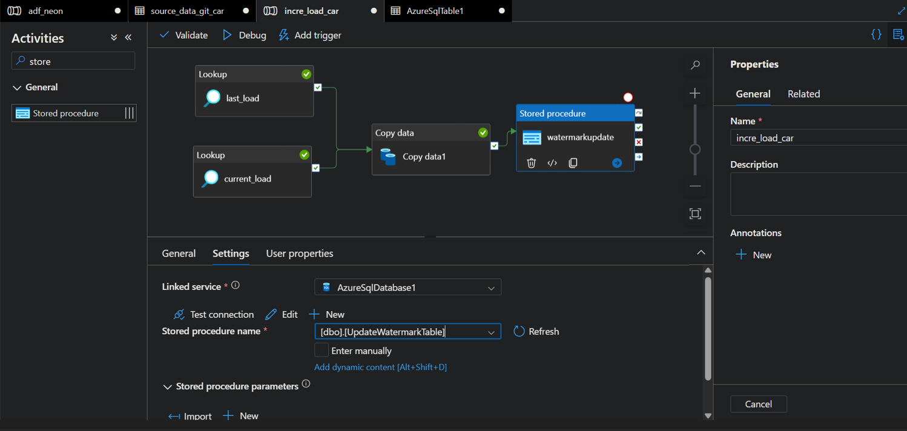

# Watermark Incremental Load — Notes

> Based on the author's Azure SQL implementation.
> Covers the concept of a watermark, the author's code, common pitfalls,
> and a concrete day-by-day walkthrough.

---

## 1. What is a Watermark?

A **watermark is a progress bookmark** — it records how far the last load got.

Every incremental ETL run has only 3 steps:

1. **Read the watermark** — where did we stop last time?
2. **Fetch the delta** — only read data newer than the watermark
3. **Update the watermark** — advance the progress after processing

```
Water_Table.Last_Load = "the point we processed up to last time"
```

It is **not a database constraint**. It is just a value plus a `WHERE` condition,
and it only works if the ETL code respects it.

---

## 2. Core Design

| Element | Purpose |
| :--- | :--- |
| `Water_Table` | Progress table, one row, stores the last processed position |
| `Date_ID` | Progress column (must be monotonically increasing, consistent format) |
| `WHERE Date_ID > watermark` | Filter condition, only fetch new rows |
| `UPDATE Water_Table` | Write back the progress as the next starting point |

**All four are needed. All four are simple.**

---

## 3. The Author's Implementation (Azure SQL / T-SQL)

### 3.1 Create the watermark table

```sql
CREATE TABLE Water_Table (
    Last_Load VARCHAR(2000)
);
```

### 3.2 Initialize the watermark

```sql
INSERT INTO Water_Table VALUES ('DT00000');
```

`DT00000` is a placeholder smaller than any real `Date_ID`,
so the first run reads the full table (acts as initial load).

### 3.3 Validate (smoke test)

```sql
-- Delta row count using DT00000
SELECT COUNT(*) FROM source_carSalesData WHERE Date_ID > 'DT00000';

-- Full table row count
SELECT COUNT(*) FROM source_carSalesData;
```

**Expected: both numbers are equal** (because `DT00000` is smaller than any
real `Date_ID`, so the whole table is read as "delta").

### 3.4 Stored procedure: update the watermark

```sql
CREATE PROCEDURE UpdateWatermarkTable
     @lastload VARCHAR(200)
AS 
BEGIN
     -- start the transaction
     BEGIN TRANSACTION;

     UPDATE Water_Table
     SET Last_Load = @lastload;

     COMMIT TRANSACTION;
END;
```

**What it does:** updates `Water_Table.Last_Load` to the value passed in.

Call it like this:

```sql
EXEC UpdateWatermarkTable @lastload = 'DT00130';
```

> Note: A single `UPDATE` is already atomic in SQL Server.
> The `BEGIN TRANSACTION / COMMIT` wrapper here is decorative — it does not add
> any real safety in this specific case.

### 3.5 The full incremental flow (conceptual)

```
① Read watermark:   SELECT Last_Load FROM Water_Table;     → 'DT00119'
② Fetch delta:      SELECT * FROM source_carSalesData
                    WHERE Date_ID > 'DT00119';
③ Process the data
④ Update watermark: EXEC UpdateWatermarkTable @lastload = 'DT00130';
⑤ Next run starts from DT00130
```

---

## 4. Why the Author Wraps It in a Stored Procedure

Because **Azure Data Factory (ADF) cannot execute a raw `UPDATE` statement.**

ADF can only:
- Call a stored procedure
- Or write data via a Copy activity

So the author packages the `UPDATE` into a stored procedure
so that ADF can invoke it in the last step of the pipeline.

---

## 5. Pitfalls of Watermark Incremental Load

### Pitfall 1 — `Date_ID` is a string, ordering is lexicographic

```
'DT00000' < 'DT00115' < 'DT00119'   ✅ lexicographic order == time order
```

**Requires:** consistent format (e.g. `DT` + fixed-width zero-padded number).
Otherwise `'DT240101'` vs `'DT20240101'` breaks lexicographic ordering
and rows will be silently skipped.

### Pitfall 2 — Multiple rows share the same `Date_ID`

```
DT00118  →  BR0229
DT00118  →  BR0230     ← same Date_ID, two rows
DT00119  →  BR0231
DT00119  →  BR0232     ← same Date_ID, two rows
```

If the watermark only records `Date_ID`, then `WHERE Date_ID > 'DT00118'`
will **skip the remaining rows with Date_ID = 'DT00118'**.

**Mitigations:**
- Composite watermark `(Date_ID, row_id)`
- Or make the downstream load idempotent (`UPSERT` / `MERGE`)

### Pitfall 3 — Watermark update and data processing are not atomic

```
Process data (30s) → crash → watermark not updated → next run reprocesses
or
Update watermark → processing fails → watermark advanced → next run misses data
```

**Correct approach:** put "process data" and "update watermark" inside
the **same transaction**, or make the load idempotent.

### Pitfall 4 — Multiple concurrent instances

Two jobs read the same watermark at the same time → duplicate processing.

**Mitigations:** `SELECT ... FOR UPDATE`, or optimistic locking
(`UPDATE ... WHERE Last_Load = <expected old value>`).

---

## 6. One-Line Summary

> **Watermark = progress table + filter condition + post-update.**
>
> The author's approach is simple and intuitive — good for teaching.
> The real difficulty is not creating the table, but **orchestration (ADF),
> boundary handling, atomicity, and concurrency.**

---

## 7. Reference: The Author's Original Code

```sql
-- Create the watermark table
CREATE TABLE Water_Table (
    Last_Load VARCHAR(2000)
);

-- Initialize
INSERT INTO Water_Table VALUES ('DT00000');

-- Validate
SELECT COUNT(*) FROM source_carSalesData WHERE Date_ID > 'DT00000';
SELECT COUNT(*) FROM source_carSalesData;

-- Stored procedure to update the watermark
CREATE PROCEDURE UpdateWatermarkTable
     @lastload VARCHAR(200)
AS 
BEGIN
     -- start the transaction
     BEGIN TRANSACTION;

     UPDATE Water_Table
     SET Last_Load = @lastload;

     COMMIT TRANSACTION;
END;
```

---

## 8. Recap: Why This Design Works

| Step | SQL | Effect |
| :--- | :--- | :--- |
| Init | `INSERT INTO Water_Table VALUES ('DT00000')` | Set the starting point |
| Read | `SELECT Last_Load FROM Water_Table` | Get the last processed position |
| Fetch delta | `WHERE Date_ID > <watermark>` | Only read new rows |
| Update | `EXEC UpdateWatermarkTable '<new>'` | Advance the bookmark |
| Repeat | — | Each run only reads the delta |

---

## 9. ADF Pipeline — The Concept

The same three SQL statements become a three-activity pipeline in Azure Data Factory:

```
┌──────────────────────────────────────────────┬────────────────────┐
│  ADF Pipeline: incremental_load              │  Example Watermark │
│                                              │                    │
│  ① Lookup activity                           │                    │
│     └─ SELECT Last_Load FROM Water_Table     │  DT00119           │
│                                              │                    │
│  ② Copy activity                             │                    │
│     └─ SELECT * FROM source_carSalesData     │                    │
│        WHERE Date_ID > 'DT00119'             │  DT00119           │
│                                              │                    │
│  ③ Stored Procedure activity                 │                    │
│     └─ EXEC UpdateWatermarkTable 'DT00130'   │  DT00130           │
└──────────────────────────────────────────────┴────────────────────┘
```

- Activity ① reads the current watermark from `Water_Table` → `DT00119`.
- Activity ② uses that value (`DT00119`) in the `WHERE` clause to fetch only the delta.
- Activity ③ writes the new max `Date_ID` (`DT00130`) back to `Water_Table`.

That is the entire idea. ADF just orchestrates the three SQL statements
you already ran manually — nothing more.

### 9.1 Actual Pipeline (Author's Implementation)

The screenshot below shows the actual pipeline in Azure Data Factory:



The pipeline has four activities:

| Activity | Type | Purpose |
| :--- | :--- | :--- |
| `last_load` | Lookup | Read the current watermark from `Water_Table` |
| `current_load` | Lookup | Read `MAX(Date_ID)` from the source table |
| `Copy data1` | Copy | Copy rows with `Date_ID > last_load` to the sink |
| `watermarkupdate` | Stored Procedure | Call `UpdateWatermarkTable` with the new watermark |

**Stored procedure settings (as shown in the screenshot):**

- **Linked service:** `AzureSqlDatabase1`
- **Stored procedure name:** `[dbo].[UpdateWatermarkTable]`
- **Parameter `lastload`:** `@{activity('current_load').output.value[0].max_data}`

**Execution order:**

```
last_load ──┐
            ├──► Copy data1 ──► watermarkupdate
current_load┘
```

- `last_load` and `current_load` run in parallel.
- `Copy data1` runs after both lookups finish.
- `watermarkupdate` runs after the copy succeeds.

---

## 10. Concrete ADF Parameter Snippets

This section collects the four concrete pieces that appear inside a real
ADF pipeline, side by side, so they can be copied directly.

### 10.1 Parameter Apply

Used when the pipeline or dataset is triggered with a runtime parameter
(e.g. a load flag pointing at a specific source path):

```
anshlambagit/Azure-DE-Project-Resources/refs/heads/main/Raw%20Data/@{dataset().load_flag}
```

- `dataset().load_flag` is a pipeline parameter passed into the dataset.
- The full string is the path to the raw data file inside the Azure repo / storage.

### 10.2 Lookup Result (from `current_load`)

The Lookup activity returns a JSON payload. Example:

```json
{
  "count": 1,
  "value": [
    {
      "max_data": "DT01245"
    }
  ],
  "effectiveIntegrationRuntime": "AutoResolveIntegrationRuntime (Australia East)"
}
```

- `value` is an **array** (because a Lookup may return multiple rows).
- The first element is at index `[0]`.
- The column name in the SELECT was aliased `max_data`.

### 10.3 Copy Data — Source Query

The Copy activity's source query uses the two Lookup outputs as dynamic
expressions:

```sql
SELECT *
FROM source_carSalesData
WHERE Date_ID <  '@{activity('current_load').output.value[0].max_data}'
  AND Date_ID >  '@{activity('last_load').output.value[0].Last_Load}'
```

> Note: The `.value[0]` is required when the Lookup does not have
> "First row only" checked. See Section 10.5.

### 10.4 Stored Procedure — Value from `current_load`

The Stored Procedure activity passes the new watermark into
`UpdateWatermarkTable`:

```
@activity('current_load').output.value[0].max_data
```

Resolves at runtime to:

```
DT01245
```

Which becomes:

```sql
EXEC UpdateWatermarkTable @lastload = 'DT01245'
```

### 10.5 Why `.value[0]` and not `.firstRow`

This depends on a checkbox inside the Lookup activity:

| "First row only" | Output shape | Path |
| :--- | :--- | :--- |
| ✅ Checked | `{ "firstRow": { "col": ... } }` | `.output.firstRow.col` |
| ❌ Unchecked | `{ "value": [ { "col": ... } ] }` | `.output.value[0].col` |

The example in 10.2 is the unchecked form (`value` array), so `.value[0]`
is required. If the Lookup is later changed to "First row only",
all downstream expressions must switch to `.firstRow`.

### 10.6 Summary Table

| Piece | Source | Value / Expression |
| :--- | :--- | :--- |
| Parameter apply | pipeline / dataset param | `.../Raw Data/@{dataset().load_flag}` |
| Lookup result | `current_load` activity | `{ "value": [ { "max_data": "DT01245" } ] }` |
| Copy data SQL | Copy activity source query | `WHERE Date_ID < @{...current_load...} AND Date_ID > @{...last_load...}` |
| Stored proc value | `current_load` output | `@activity('current_load').output.value[0].max_data` |

---

## 11. A Real Debugging Story — Missing Stored Procedure and Idempotency

This section documents a real problem encountered while following the tutorial.
It is a concrete example of why the watermark must be updated in the same run.

### 11.1 What happened

The pipeline has four activities:

```
① Lookup last_load
② Lookup current_load
③ Copy data
④ Stored Procedure (UpdateWatermarkTable)
```

On the first run, only the first three activities were executed.
The Stored Procedure activity was skipped.

Result:

```
Copy data read the full table (1849 rows)
Copy data wrote one file to Blob (65.4 KiB)
Water_Table.Last_Load stayed at DT00000   ← never advanced
```

On the second run, all four activities were executed.

Result:

```
① last_load       → DT00000   (unchanged, because the first run never updated it)
② current_load    → DT01245
③ Copy data       → WHERE Date_ID > 'DT00000'
                  → read 1849 rows again → wrote a second file with the same data
④ Stored Procedure → Water_Table.Last_Load = DT01245
```

**Two files, identical content. That is a duplicate.**

### 11.2 Why it happened

Because the first run never updated the watermark, the second run started from
the same old watermark `DT00000` and re-read the entire table.

This is exactly the failure mode described in Section 5, Pitfall 3:

> If "process data" and "update watermark" are not performed together,
> the next run will either duplicate data (watermark too old)
> or skip data (watermark advanced past unprocessed rows).

### 11.3 How it was fixed

1. **Truncate the target and the watermark table.**
   ```sql
   TRUNCATE TABLE Water_Table;
   INSERT INTO Water_Table VALUES ('DT00000');
   ```
   (Blob files were also cleaned up.)

2. **Run the pipeline again with all four activities enabled.**

   This time the full flow executed:

   ```
   ① last_load       → DT00000
   ② current_load    → DT01245
   ③ Copy data       → 1849 rows → file A (65.4 KiB)
   ④ Stored Procedure → Water_Table.Last_Load = DT01245
   ```

3. **Run the pipeline one more time without changing the source.**

   ```
   ① last_load       → DT01245
   ② current_load    → DT01245   (nothing new)
   ③ Copy data       → 0 rows    → file B (416 B, empty)
   ④ Stored Procedure → Water_Table.Last_Load = DT01245
   ```

**The second run produced only a 416-byte empty file, not a full reload.**

### 11.4 What this proves

- The watermark advanced correctly (`DT00000` → `DT01245`).
- The incremental filter worked (`WHERE Date_ID > 'DT01245'` returned 0 rows).
- The pipeline is now idempotent in effect: re-running it does not
  duplicate the actual data.

The empty file (416 B) is still produced by the Copy activity even when
there are no new rows. Downstream consumers can safely ignore it, or the
pipeline can be modified with an If Condition to skip the write entirely
when `current_load` is NULL.

### 11.5 Lesson

- **Always run the full pipeline.** Skipping the Stored Procedure
  means the watermark never advances, and every subsequent run
  reloads the same data.
- **Truncate + reset is a repair step, not a design.** The goal is to make
  the pipeline idempotent so that re-runs never need manual cleanup.
- **Check the watermark after every run:** `SELECT * FROM Water_Table;`.
  If it hasn't changed, something in the pipeline is incomplete.

---  

## 12. dbt Transformation — Bronze to Silver

The original tutorial performs the Bronze → Silver transformation in a
Databricks notebook using PySpark DataFrame operations. This project
replaces that step with **dbt**, which performs the same transformation
using SQL and manages the output as a Unity Catalog table.

### 12.1 What the Author Does (PySpark)

In the original tutorial, the transformation is done in a notebook:

```python
df = spark.read.parquet("abfss://bronze@xxx.dfs.core.windows.net/rawdata")

# Add two columns
df = df.withColumn('Model_catalog', split(col('Model_ID'), '-')[0])
df = df.withColumn('RevPerUnit', round(col('Revenue') / col('Units_Sold'), 2))

# Write to Silver
df.write.parquet("abfss://silver@xxx.dfs.core.windows.net/carsales")
```

The result is a set of Parquet files in the `silver` container.
No table is registered anywhere.

### 12.2 What This Project Does (dbt)

Instead of PySpark, the transformation is written as a dbt SQL model.
Two extra steps are required first, because dbt operates on tables,
not on raw Parquet paths.

**Step 1 — Register the Bronze Parquet as an external table.**

In a Databricks notebook:

```python
df = spark.read.parquet("abfss://bronze@xc797demo.dfs.core.windows.net/rawdata")
df.createOrReplaceTempView("rawdata_temp")

spark.sql("""
    CREATE TABLE IF NOT EXISTS cars_catalog.bronze.rawdata
    USING parquet
    LOCATION 'abfss://bronze@xc797demo.dfs.core.windows.net/rawdata'
""")
```

Now `cars_catalog.bronze.rawdata` is a queryable table in Unity Catalog.

**Step 2 — Declare the source in dbt.**

`models/bronze/source.yml`:

```yaml
version: 2

sources:
  - name: bronze
    database: cars_catalog
    schema: bronze
    tables:
      - name: rawdata
```

**Step 3 — Write the Silver model in dbt.**

`models/silver/silver_car.sql`:

```sql
{{ config(materialized='table', schema='silver') }}

SELECT
    Branch_ID,
    Dealer_ID,
    Model_ID,
    Revenue,
    Units_Sold,
    Date_ID,
    Day,
    Month,
    Year,
    BranchName,
    DealerName,
    Product_Name,
    SPLIT(Model_ID, '-')[0] AS Model_catalog,
    ROUND(Revenue / NULLIF(Units_Sold, 0), 2) AS RevPerUnit,
    CURRENT_TIMESTAMP() AS silver_loaded_at
FROM {{ source('bronze', 'rawdata') }}
```

**Step 4 — Run dbt.**

```powershell
dbt run --select silver_car
```

The result is a Unity Catalog table `cars_catalog.silver.silver_car`.

### 12.3 Comparison

| Aspect | Author (PySpark) | This Project (dbt) |
| :--- | :--- | :--- |
| Transformation tool | PySpark DataFrame | dbt SQL model |
| Bronze representation | Parquet files in Blob | Unity Catalog external table |
| Silver output | Parquet files in Blob | Unity Catalog table |
| Extra step required | None | Register Bronze as a table |
| Version control | Notebook | SQL files in Git |
| Re-runnable | Manual | `dbt run` |
| Lineage | Manual | Automatic (dbt DAG) |

### 12.4 Why This Project Uses dbt

- The transformation is expressed as **plain SQL**, which is easier to
  review, version control, and test than a notebook.
- dbt handles **materialization** (table / view / incremental) automatically.
- dbt provides **lineage** (`ref()` / `source()`) and **tests** out of the box.
- The output is a **Unity Catalog table**, queryable with SQL directly.

The trade-off is one extra setup step: the Bronze Parquet must be
registered as a table before dbt can read it. This is a one-time cost.

---

---

## 13. dbt vs Classical PySpark SCD Type 1 — Method Comparison

This section compares two implementations of the same Medallion architecture:

- **Classical approach (author's tutorial):** PySpark + Delta Lake MERGE, all in Databricks notebooks.
- **dbt approach (this project):** dbt SQL models against Unity Catalog tables.

Both produce the same result: a star schema with four dimensions and one fact table.

---

### 13.1 Architecture Side by Side

**Classical (author's PySpark)**

```
Bronze (Blob Parquet)
    │  Spark read.parquet
    ▼
Silver (Blob Parquet, +2 columns via withColumn)
    │  Spark read.parquet + DeltaTable.merge
    ▼
Gold
    ├── dim_dealer     (Blob Parquet + Unity Catalog table)
    ├── dim_model      (same pattern)
    ├── dim_branch     (same pattern)
    ├── dim_date       (same pattern)
    └── fact_sales     (join in PySpark, MERGE in)
```

**dbt (this project)**

```
Bronze (Blob Parquet)
    │  Databricks Notebook (one-time)
    ▼
Bronze: cars_catalog.bronze.rawdata  (external table)
    │  dbt model: silver_car
    ▼
Silver: cars_catalog.silver.silver_car
    │  dbt models: dim_dealer, dim_model, dim_branch, dim_date
    ▼
Gold:
    ├── cars_catalog.gold.dim_dealer
    ├── cars_catalog.gold.dim_model
    ├── cars_catalog.gold.dim_branch
    ├── cars_catalog.gold.dim_date
    └── cars_catalog.gold.fact_sales
    │  dbt test (28 tests)
    ▼
All checks passed
```

---

### 13.2 Step-by-Step Comparison

| Step | Classical (PySpark) | dbt |
| :--- | :--- | :--- |
| **Bronze** | Read Parquet from Blob | `source('bronze', 'rawdata')` |
| **Silver** | `df.withColumn(...)` ×2, write Parquet | `silver_car.sql` with `config(materialized='table')` |
| **Surrogate key** | `ROW_NUMBER() OVER (ORDER BY ...)` | `dbt_utils.generate_surrogate_key([...])` |
| **Full load** | `if incremental_flag == '0'` then `df.write.mode('overwrite')` | dbt handles automatically on first run |
| **Incremental** | `DeltaTable.merge()` with `whenMatchedUpdateAll().whenNotMatchedInsertAll()` | `config(materialized='incremental', unique_key='...')` |
| **New key allocation** | `max_value = spark.sql("SELECT MAX(dim_model_key)")` then `row_number + max_value` | Not needed — hash key is stateless |
| **Null handling** | `COALESCE` or filter before write | `COALESCE` in SQL |
| **Fact join** | PySpark `df.join(...)` chain | SQL `LEFT JOIN` chain |
| **Testing** | Manual SQL checks in notebooks | 28 dbt tests, run with `dbt test` |
| **Orchestration** | Databricks Job with task dependencies | `dbt run` — `ref()` resolves DAG automatically |
| **Scheduling** | Databricks Workflows schedule | External (GitHub Actions, Airflow, Databricks Job) |

---

### 13.3 Same SCD Type 1 Logic, Different Expression

**Classical PySpark SCD Type 1 (dim_model, simplified):**

```python
if not spark.catalog.tableExists('cars_catalog.gold.dim_model'):
    df_sink = spark.sql('''
        SELECT 1 AS dim_model_key, Model_ID, model_category
        FROM parquet.`abfs://silver@.../carsales`
        WHERE 1=0
    ''')
else:
    df_sink = spark.sql('''
        SELECT dim_model_key, Model_ID, model_category
        FROM cars_catalog.gold.dim_model
    ''')

df_filter = df_src.join(df_sink, df_src['Model_ID'] == df_sink['Model_ID'], 'left') \
    .select(df_src['Model_ID'], df_src['model_category'], df_sink['dim_model_key'])

df_filter_old = df_filter.filter(df_filter['dim_model_key'].isNull())

if incremental_flag == '0':
    max_value = 0
else:
    max_value = spark.sql("SELECT MAX(dim_model_key) FROM cars_catalog.gold.dim_model").collect()[0][0]

# Assign new keys
df_filter_old = df_filter_old.withColumn("dim_model_key",
                                         row_number().over(Window.orderBy("Model_ID")) + max_value)

df_final = df_filter.filter(df_filter['dim_model_key'].isNotNull()).union(df_filter_old)

delta_tbl = DeltaTable.forName(spark, 'cars_catalog.gold.dim_model')
delta_tbl.alias("trg").merge(df_final.alias("src"), "trg.dim_model_key = src.dim_model_key") \
    .whenMatchedUpdateAll() \
    .whenNotMatchedInsertAll() \
    .execute()
```

**dbt SCD Type 1 equivalent (dim_model):**

```sql
{{ config(materialized='incremental', schema='gold', unique_key='Model_ID') }}

WITH model_dedup AS (
    SELECT
        Model_ID,
        SPLIT(Model_ID, '-')[0] AS model_category
    FROM {{ ref('silver_car') }}
    GROUP BY Model_ID, SPLIT(Model_ID, '-')[0]
)

SELECT
    {{ dbt_utils.generate_surrogate_key(['Model_ID']) }} AS dim_model_key,
    Model_ID,
    model_category
FROM model_dedup
```

**Same result. ~5 lines vs ~30 lines.**

---

### 13.4 Why Hash Keys Are Better Than Auto-Increment Integers

The classical approach uses `ROW_NUMBER()` + `MAX(dim_model_key)` to allocate integers. dbt uses `generate_surrogate_key` (a hash).

| Aspect | Integer (author) | Hash (dbt) |
| :--- | :--- | :--- |
| Stability across reruns | ❌ May change | ✅ Stable |
| Concurrency-safe | ❌ Two jobs can collide | ✅ No collision |
| Requires max lookup | ✅ Yes | ❌ No |
| Readability | ✅ Human-readable | ❌ Opaque |
| Join performance | ✅ Fast (int) | ⚠️ Slightly slower (string) |

For production pipelines, **hash keys are the safer default**. Integer keys can work if you carefully serialize key allocation, but it's easy to get wrong.

---

### 13.5 What the dbt Version Does Not Have

The dbt version intentionally omits a few things the classical version does:

1. **Explicit `incremental_flag` widget** — dbt decides full vs incremental automatically based on whether the table exists.
2. **Explicit new-key allocation** — hash keys don't need a max-value lookup.
3. **Manual `DeltaTable.merge()` calls** — dbt generates the MERGE statement.
4. **Manual Databricks Job orchestration** — `dbt run` orders models by `ref()` dependencies.
5. **Per-activity task definitions** — `ref()` replaces hand-drawn DAG edges.

---

### 13.6 What You Gain with dbt

| Benefit | Explanation |
| :--- | :--- |
| **SQL instead of PySpark** | Easier to review, test, and hand off |
| **Version control** | SQL files in Git, reviewable via PRs |
| **Built-in tests** | `dbt test` with 28 assertions on dimensions and facts |
| **Lineage** | `ref()` and `source()` produce a full DAG |
| **Idempotency** | Rerunning `dbt run` produces the same result |
| **Documentation** | `dbt docs generate` produces browsable docs |
| **Portability** | Same SQL runs on Snowflake, BigQuery, Redshift, Postgres |
| **Simplicity** | ~50 lines of SQL replaces ~200 lines of PySpark |

---

### 13.7 When to Still Use PySpark

dbt is not a replacement for all Spark work:

| Task | Recommended tool |
| :--- | :--- |
| Raw file ingestion (Blob → table) | Spark notebook |
| Complex nested JSON processing | Spark notebook |
| ML feature engineering | Spark notebook |
| **Dimensional modeling (Silver → Gold)** | **dbt** |
| **Business logic SQL transformations** | **dbt** |
| **Data quality tests** | **dbt test** |

**Recommended split:**

```
Spark notebook   → Bronze → Silver
dbt              → Silver → Gold  (+ tests)
```

---

### 13.8 Incremental Data and Git

The final part of the tutorial covers git-based incremental data handling:

- **Source data arrives as new files in a Git repository or Blob container.**
- **ADF copies new files to Blob** (Bronze).
- **Watermark (`Water_Table`) tracks the last processed `Date_ID`.**
- **Only rows newer than the watermark are loaded.**
- **dbt processes the delta and updates downstream dimensions and facts.**

**With dbt, incremental handling becomes:**

```sql
{{ config(materialized='incremental', unique_key='...') }}

SELECT ... FROM {{ ref('silver_car') }}


WHERE Date_ID > (SELECT MAX(Date_ID) FROM {{ this }})

```

**No `incremental_flag` widget. No `DeltaTable.merge()` written by hand. dbt generates the MERGE.**

---

### 13.9 Summary

| | Classical | dbt |
| :--- | :--- | :--- |
| Lines of code | ~200 | ~50 |
| Language | PySpark + SQL | SQL only |
| Key generation | ROW_NUMBER + MAX | Hash (dbt_utils) |
| SCD Type 1 | Hand-written MERGE | `materialized='incremental'` |
| Testing | Manual | 28 dbt tests |
| Orchestration | Databricks Job | `dbt run` |
| Lineage | Manual | Automatic |
| Rerun safety | Manual reasoning | Idempotent by design |

**Both approaches reach the same Gold layer. The dbt approach is shorter, testable, version-controlled, and portable. The classical approach is more explicit and teaches the underlying mechanics.**

**Understanding the classical approach makes you better at debugging dbt. Understanding dbt makes you faster at shipping.**

---
---

## 14. Incremental Data — End-to-End Verification

This section documents the end-to-end verification of incremental data
flowing from the source file all the way to the Gold layer fact table.

### 14.1 The Incremental Source

A new file is added to the Git repository:

**`Azure-DE-Project-Resources/Raw Data/IncrementalSales.csv`**

```
Branch_ID  Dealer_ID  Model_ID  Revenue    Units_Sold  Date_ID   Day  Month  Year  BranchName           DealerName               Product_Name
BR9546     DLR0060    Jee-M10   7223451    1           DT01246   28   5      2020  Premier Motors       Fisker, Karma Motors     Jeep
BR9666     DLR0062    Jee-M12   22093020   3           DT01246   30   5      2020  Puma Motors          Ford Australia Motors    Jeep
BR9726     DLR0063    Jee-M13   22372413   3           DT01247   31   5      2020  Power Ranger Motors  Ford do Brasil Motors    Jeep
XYZ9726    XYZ0063    ZYXM13    22372413   3           DT01247   31   5      2020  DataFam Motors       DataFam Dealers          Surprise
```

**Key observation:** Row 4 (`XYZ9726` / `XYZ0063` / `ZYXM13`) consists
entirely of **new dimension members** that do not exist in any
previously loaded data.

### 14.2 Expected Behavior

When the pipeline runs against this incremental data:

| Table | Expected change |
| :--- | :--- |
| `dim_branch` | +1 row for `XYZ9726` |
| `dim_dealer` | +1 row for `XYZ0063` |
| `dim_model` | +1 row for `ZYXM13` |
| `dim_date` | +2 rows for `DT01246`, `DT01247` |
| `fact_sales` | +5 rows |

The four `dim_*` models are `materialized='incremental'`, so dbt
performs a MERGE against each dimension table. Existing members
are matched by their business key and left alone; new members are
inserted with freshly generated hash keys.

### 14.3 Verification Results

**`dim_branch` (1840 rows)** — the new branch is present:

```
dim_branch_key  branch_id  branchname
...
90ddb7fa...     XYZ9726    DataFam Motors
```

**`dim_dealer` (268 rows)** — the new dealer is present:

```
dim_dealer_key  dealer_id  dealername
...
12ccb84764...   XYZ0063    DataFam Dealers
```

**`dim_model` (278 rows)** — the new model is present:

```
dim_model_key  model_id  model_category
...
3a793f48...    ZYXM13    ZYXM13
```

**`dim_date` (1158 rows)** — the new dates are present:

```
dim_date_key    date_id
...
7b8c006fa1...   DT01246
2e81e27d63...   DT01247
```

**`fact_sales`** — the new fact row is present and correctly joined:

```sql
SELECT * FROM cars_catalog.gold.fact_sales
WHERE dim_dealer_key = (
    SELECT dim_dealer_key FROM cars_catalog.gold.dim_dealer
    WHERE dealer_id = 'XYZ0063'
);
```

| dim_date_key | date_id | day | month | year | revenue | units_sold | revperunit |
| :--- | :--- | :--- | :--- | :--- | :--- | :--- | :--- |
| 81e27d63... | DT01247 | 31 | 5 | 2020 | 22372413.00 | 3 | 7457471.00 |

This matches the source row exactly. The Gold layer fact table
correctly joins every foreign key to the newly inserted dimension
rows.

### 14.4 What This Proves

- **dbt's `incremental` materialization correctly handles new
  dimension members.** No manual new-key allocation is needed — the
  hash key is computed from the business key on the fly.
- **No orphan rows are produced.** `dbt test` verifies that every
  `fact_sales.*_key` exists in its corresponding dimension.
- **Referential integrity is maintained end-to-end.**
- **The pipeline is idempotent.** Rerunning `dbt run` produces the
  same result — dbt's MERGE replaces matching keys and inserts
  new ones, with no duplicates.
- **The SCD Type 1 behavior matches the author's PySpark
  implementation**, but is expressed in ~5 lines of SQL instead
  of ~30 lines of PySpark.

### 14.5 Summary

| Test | Result |
| :--- | :--- |
| `dbt test` | 28 / 28 PASS |
| New dimension members inserted | ✅ (branch, dealer, model, date) |
| New fact rows inserted | ✅ (5 rows) |
| No orphan FK in fact table | ✅ |
| End-to-end field consistency | ✅ (row 4 verified) |

**The incremental pipeline is verified end-to-end.**

---

## References

- **YouTube tutorial:**  
  Azure End-To-End Data Engineering Project (Job Ready) | Azure Data Engineering Bootcamp  
  https://www.youtube.com/watch?v=6_hXeNg9TJ0&t=3s

- **Raw data repository (GitHub):**  
  anshlambagit / Azure-DE-Project-Resources / Raw Data  
  https://github.com/anshlambagit/Azure-DE-Project-Resources/tree/main/Raw%20Data
