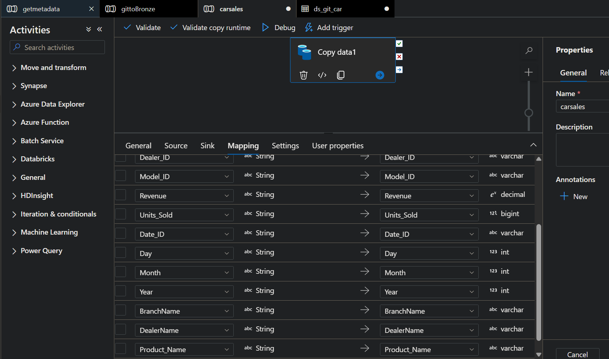
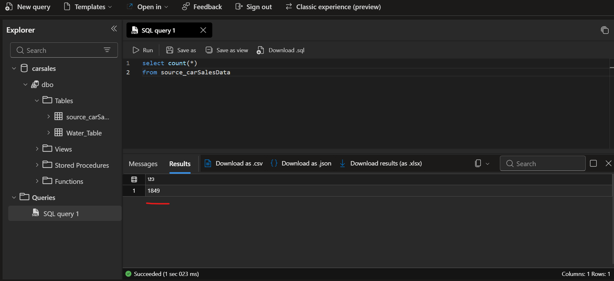
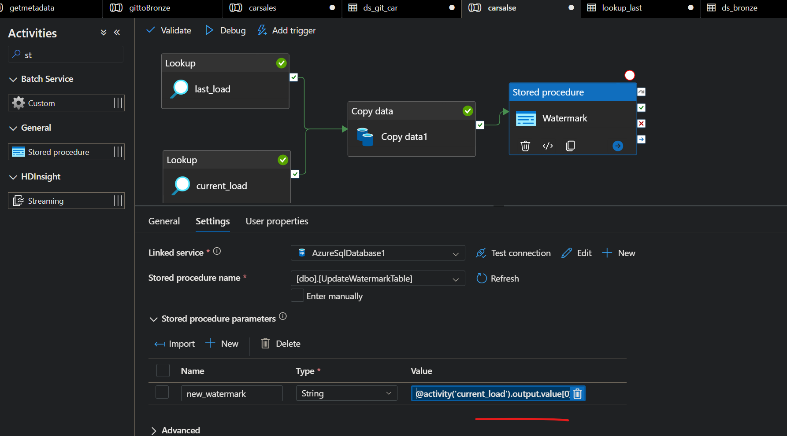

# Azure End-to-End Car Sales Data Engineering Project

> Work in progress — ADF source ingestion and schema mapping are being configured. Subsequent sections document the implementation plan and lessons from the earlier tutorial-based implementation; they are not evidence of a successful run of the revised architecture.

## 1. Project Overview

This project demonstrates parameterized data ingestion, full and incremental extraction, and dimensional modeling using Azure Data Factory (ADF), Azure SQL Database, ADLS Gen2, Databricks Free Edition and dbt. A public GitHub CSV dataset simulates an operational source system.

## 2. End-to-End Architecture

```text
GitHub raw CSV
    | ADF HTTP connector / parameterized Copy activity
    v
Azure SQL Database (dbo.source_carSalesData)
    | ADF full load, then watermark-based incremental extraction
    v
ADLS Gen2 (Parquet)
    | Pandas + SAS URL / file tracking 
    v
Databricks Free Edition — Bronze managed Delta table
    | dbt
    v
Silver — cleaning and transformation
    | dbt
    v
Gold — star schema and data quality tests
```

| Component | Responsibility |
| --- | --- |
| GitHub | Raw CSV source; Git also versions project code |
| ADF | Linked services, datasets, parameterization, copying and orchestration |
| Azure SQL | Relational source and watermark state |
| ADLS | Durable raw Parquet files |
| Databricks / Pandas | File ingestion and Delta storage |
| dbt | SQL transformations, dimensional models and tests |

Development order: establish connectivity and full load, introduce incremental extraction, then implement and validate downstream models.

## 3. Data Source — GitHub

Source: https://github.com/anshlambagit/Azure-DE-Project-Resources/tree/main/Raw%20Data

| File | Purpose |
| --- | --- |
| `SalesData.csv` | Initial historical data |
| `IncrementalSales.csv` | Additional records for incremental testing |

The dataset contains branch, dealer, model, revenue, units sold, date identifiers and descriptive attributes. `Date_ID` is a fixed-format string used as the extraction watermark, not a native date or a unique row identifier.

## 4. Azure Infrastructure Setup

Configure an Azure SQL logical server (`adfpro9`), database (`carsales`), ADF instance and ADLS Gen2 storage account. The selected SQL configuration is Basic, 500 MB, no elastic pool; verify deployment and cost in the portal. Locally redundant backups are sufficient for this development scenario. Configure network access and authentication for ADF; do not commit credentials or SAS tokens.

## 5. Initial Data Ingestion — GitHub to Azure SQL

### 5.1 HTTP Linked Service

Use the HTTP connector with Anonymous authentication for the public raw GitHub endpoint.

Base URL:

```text
https://raw.githubusercontent.com/
```

Relative URL:

```text
anshlambagit/Azure-DE-Project-Resources/refs/heads/main/Raw%20Data/SalesData.csv
```

The base and relative URLs resolve to the raw CSV rather than the GitHub HTML page. `%20` encodes the space in `Raw Data`.

### 5.2 Parameterized Dataset

Create a DelimitedText dataset `ds_git_car` with comma delimiter and first row as header. Add a String dataset parameter named `load_flag` and replace the static filename with:

```text
anshlambagit/Azure-DE-Project-Resources/refs/heads/main/Raw%20Data/@{dataset().load_flag}
```

`@{...}` is string interpolation: ADF embeds the evaluated parameter in the static path. Supply `SalesData.csv` for the initial load and `IncrementalSales.csv` for the additional file. The same dataset can be reused for compatible files.

Optionally create a pipeline String parameter `load_flag` and pass it to the dataset in the Copy activity Source tab using `@pipeline().parameters.load_flag`. This is a proposed enhancement, not a confirmed configuration.

File selection is distinct from row-level watermark extraction.

### 5.3 Azure SQL Sink and Schema Mapping

Create an Azure SQL linked service and dataset targeting `dbo.source_carSalesData`. Create the target table with appropriate lengths and numeric precision before copying, or verify the schema if using automatic table creation. In pipeline `carsales`, configure the Copy activity with `ds_git_car` as source and the SQL dataset as sink. Import schemas in the Mapping tab and review column mappings and compatible type conversions.

| CSV column | Source type | SQL sink type |
| --- | --- | --- |
| Branch_ID | String | VARCHAR |
| Dealer_ID | String | VARCHAR |
| Model_ID | String | VARCHAR |
| Revenue | String | DECIMAL |
| Units_Sold | String | BIGINT |
| Date_ID | String | VARCHAR |
| Day | String | INT |
| Month | String | INT |
| Year | String | INT |
| BranchName | String | VARCHAR |
| DealerName | String | VARCHAR |
| Product_Name | String | VARCHAR |

Mapping is based on the supplied ADF screenshot and source notes; exact lengths and decimal precision must be checked in SQL. Save the mapping screenshot under `assets/adf_schema_mapping.png` when organizing the repository.

**ADF Copy Activity — Schema Mapping**



### 5.4 Initial Full Load and Validation

Run the pipeline with `load_flag = SalesData.csv` using Insert behavior. Validate ADF rows read/copied and the destination:

```sql
SELECT TOP (10) * FROM dbo.source_carSalesData;
SELECT COUNT(*) AS total_rows FROM dbo.source_carSalesData;
SELECT MIN(Date_ID) AS min_date_id, MAX(Date_ID) AS max_date_id
FROM dbo.source_carSalesData;
SELECT COLUMN_NAME, DATA_TYPE, CHARACTER_MAXIMUM_LENGTH,
       NUMERIC_PRECISION, NUMERIC_SCALE
FROM INFORMATION_SCHEMA.COLUMNS
WHERE TABLE_SCHEMA = 'dbo' AND TABLE_NAME = 'source_carSalesData'
ORDER BY ORDINAL_POSITION;
```

Record actual results after execution. Repeating an Insert-based load of the same CSV may duplicate records; use a controlled reset for baseline testing or design an idempotent source ingestion mechanism.

### Initial Load — Execution Verification

After executing the ADF Copy activity, the initial data load
was validated directly in Azure SQL Database.

```sql
SELECT COUNT(*) AS total_rows
FROM dbo.source_carSalesData;
```

**Validation Result:**

| Validation Item | Result |
| :--- | :--- |
| Source file | SalesData.csv |
| Target table | dbo.source_carSalesData |
| Load type | Initial Full Load |
| Total rows loaded | 1,849 |
| SQL validation | Passed |



The target table contains 1,849 records, establishing the
baseline for subsequent incremental load validation.

## 6. Full Load — Azure SQL to ADLS

Create a second ADF Copy pipeline with Azure SQL as source and an ADLS Gen2 Parquet dataset as sink. Example test destination: `bronze/rawdata/full_load/`.

```sql
SELECT * FROM dbo.source_carSalesData;
```

Validate the pipeline status, row counts, Parquet files and schema. Full load provides a baseline before adding Lookup activities and a stored procedure. Keep baseline files separate from incremental output, or clear the test output before initializing the incremental pipeline from zero.

Repeated full extraction moves previously processed records unnecessarily. The next phase introduces a watermark to extract only new rows.

## 7. Watermark Design

A watermark is a progress bookmark, not a database constraint. Read the last successful position, extract the delta, and advance the position only after the sink write succeeds. The design uses `Water_Table.Last_Load` and the fixed-width `Date_ID` column.


### 7.1 Create the watermark table

```sql
CREATE TABLE Water_Table (
    Last_Load VARCHAR(2000)
);
```

### 7.2 Initialize the watermark

```sql
INSERT INTO Water_Table VALUES ('DT00000');
```

`DT00000` is a placeholder smaller than any real `Date_ID`,
so the first run reads the full table (acts as initial load).

### 7.3 Validate (smoke test)

```sql
-- Delta row count using DT00000
SELECT COUNT(*) FROM source_carSalesData WHERE Date_ID > 'DT00000';

-- Full table row count
SELECT COUNT(*) FROM source_carSalesData;
```

**Expected: both numbers are equal** (because `DT00000` is smaller than any
real `Date_ID`, so the whole table is read as "delta").

### 7.4 Stored procedure: update the watermark

```sql
CREATE PROCEDURE UpdateWatermarkTable
     @lastload VARCHAR(200)
AS 
BEGIN
     -- start the transaction
     BEGIN TRANSACTION;

     UPDATE Water_Table
     SET Last_Load = @lastload;

     COMMIT TRANSACTION;
END;
```

**What it does:** updates `Water_Table.Last_Load` to the value passed in.

Call it like this:

```sql
EXEC UpdateWatermarkTable @lastload = 'DT00130';
```

> Note: A single `UPDATE` is already atomic in SQL Server.
> The `BEGIN TRANSACTION / COMMIT` wrapper here is decorative — it does not add
> any real safety in this specific case.

### 7.5 The full incremental flow (conceptual)

```
① Read watermark:   SELECT Last_Load FROM Water_Table;     → 'DT00119'
② Fetch delta:      SELECT * FROM source_carSalesData
                    WHERE Date_ID > 'DT00119' AND Date_ID <= 'DT00130';
③ Process the data
④ Update watermark: EXEC UpdateWatermarkTable @lastload = 'DT00130';
⑤ Next run starts from DT00130
```

---

### 7.6 Stored Procedure and Boundary Conditions

ADF can execute SQL through Script activity as well as call stored procedures. This project uses a Stored Procedure activity to encapsulate the watermark update. A single SQL UPDATE is atomic, but the SQL update and ADLS write are not a single transaction.

Use `old_watermark < Date_ID <= new_watermark` to include the maximum row. The original notes used a strict upper bound, which can skip rows at the maximum when the watermark advances. Initialize from `DT00000` only when the incremental destination is empty; otherwise initialize from the verified baseline maximum.

### 7.7 Watermark Column Selection — Date_ID vs Timestamp

A watermark does not necessarily have to be a timestamp.
It can be any column that reliably represents the progress
of data ingestion or modification.

| Watermark Column | Example | Purpose |
| :--- | :--- | :--- |
| `created_at` | 2026-11-25 10:00:00 | Track newly created records |
| `updated_at` | 2026-11-25 12:00:00 | Track inserted or updated records |
| `ingested_at` | 2026-11-25 14:00:00 | Track newly ingested records |
| `sequence_id` | 1849 | Track increasing sequence values |
| `Date_ID` | DT01245 | Track increasing source identifiers |

In this project, `Date_ID` is used as the watermark column
instead of a conventional timestamp.

The source dataset contains fixed-width identifiers such as:

```text
DT00001
DT00002
DT00003
...
DT01245
```

Because the numeric portion is consistently zero-padded,
lexicographical ordering follows the numeric identifier order.

This allows SQL Server to perform comparisons such as:

```sql
SELECT *
FROM dbo.source_carSalesData
WHERE Date_ID > 'DT01245';
```

The underlying concept is the same as timestamp-based
incremental processing used in dbt.

#### Important Limitation

`Date_ID` is not a unique row identifier, and multiple
records may share the same value.

It is also not necessarily a chronological representation
of the actual business date.

The watermark design therefore assumes that newly arriving
records have a Date_ID greater than the previously
processed watermark.

Late-arriving records with an older or identical Date_ID,
updates to existing records, and source deletions are not
automatically captured by this approach.

For production workloads, an appropriate modification
timestamp, composite watermark, or CDC mechanism may
provide more reliable change detection.

## 8. ADF Incremental Pipeline

### 8.1 Actual Pipeline (Author's Implementation)

The screenshot below shows the actual pipeline in Azure Data Factory:

Screenshot to capture: `assets/store_procedure.png`.

**ADF Watermark Incremental Load Pipeline**



The pipeline has four activities:

| Activity | Type | Purpose |
| :--- | :--- | :--- |
| `last_load` | Lookup | Read the current watermark from `Water_Table` |
| `current_load` | Lookup | Read `MAX(Date_ID)` from the source table |
| `Copy data1` | Copy | Copy rows with `last_load < Date_ID <= current_load` to the sink |
| `watermarkupdate` | Stored Procedure | Call `UpdateWatermarkTable` with the new watermark |

**Stored procedure settings (as shown in the screenshot):**

- **Linked service:** `AzureSqlDatabase1`
- **Stored procedure name:** `[dbo].[UpdateWatermarkTable]`
- **Parameter `lastload`:** `@{activity('current_load').output.value[0].max_data}`

**Execution order:**

```
last_load ──┐
            ├──► Copy data1 ──► watermarkupdate
current_load┘
```

- `last_load` and `current_load` run in parallel.
- `Copy data1` runs after both lookups finish.
- `watermarkupdate` runs after the copy succeeds.

---

### 8.2 Lookup Result (from `current_load`)

The Lookup activity returns a JSON payload. Example:

```json
{
  "count": 1,
  "value": [
    {
      "max_data": "DT01245"
    }
  ],
  "effectiveIntegrationRuntime": "AutoResolveIntegrationRuntime (Australia East)"
}
```

- `value` is an **array** (because a Lookup may return multiple rows).
- The first element is at index `[0]`.
- The column name in the SELECT was aliased `max_data`.

### 8.3 Copy Data — Source Query

The Copy activity's source query uses the two Lookup outputs as dynamic
expressions:

```sql
SELECT *
FROM source_carSalesData
WHERE Date_ID <= '@{activity('current_load').output.value[0].max_data}'
  AND Date_ID >  '@{activity('last_load').output.value[0].Last_Load}'
```

> Note: The `.value[0]` is required when the Lookup does not have
> "First row only" checked. See Section 8.5.

### 8.4 Stored Procedure — Value from `current_load`

The Stored Procedure activity passes the new watermark into
`UpdateWatermarkTable`:

```
@activity('current_load').output.value[0].max_data
```

Resolves at runtime to:

```
DT01245
```

Which becomes:

```sql
EXEC UpdateWatermarkTable @lastload = 'DT01245'
```

### 8.5 Why `.value[0]` and not `.firstRow`

This depends on a checkbox inside the Lookup activity:

| "First row only" | Output shape | Path |
| :--- | :--- | :--- |
| ✅ Checked | `{ "firstRow": { "col": ... } }` | `.output.firstRow.col` |
| ❌ Unchecked | `{ "value": [ { "col": ... } ] }` | `.output.value[0].col` |

The example in 8.2 is the unchecked form (`value` array), so `.value[0]`
is required. If the Lookup is later changed to "First row only",
all downstream expressions must switch to `.firstRow`.

### 8.6 Summary Table

| Piece | Source | Value / Expression |
| :--- | :--- | :--- |
| File selection | Dataset parameter | `@{dataset().load_flag}` (Section 5) |
| Lookup result | `current_load` activity | `{ "value": [ { "max_data": "DT01245" } ] }` |
| Copy data SQL | Copy activity source query | `WHERE Date_ID <= @{...current_load...} AND Date_ID > @{...last_load...}` |
| Stored proc value | `current_load` output | `@activity('current_load').output.value[0].max_data` |

---

### 8.7 No-change handling

Optionally add an If Condition after both Lookups to skip Copy and watermark update when the source maximum is NULL or not greater than the old watermark. Configure pipeline concurrency to prevent overlapping runs. Only advance the watermark on successful Copy.

### 8.8 Why Two Lookup Activities? — Watermark Boundaries

The incremental pipeline uses two Lookup activities to
establish a bounded extraction window.

- `last_load`: Where did the previous successful load stop?
- `current_load`: Where should the current load stop?

#### Step 1 — Read the Previous Watermark

```sql
SELECT Last_Load
FROM dbo.Water_Table;
```

Example result:

```text
DT00000
```

This represents the lower boundary of the current extraction.

#### Step 2 — Capture the Current Source Boundary

```sql
SELECT MAX(Date_ID) AS max_data
FROM dbo.source_carSalesData;
```

Example result:

```text
DT01245
```

This represents the upper boundary of the current extraction.

#### Step 3 — Extract the Bounded Data Range

```sql
SELECT *
FROM dbo.source_carSalesData
WHERE Date_ID > 'DT00000'
  AND Date_ID <= 'DT01245';
```

The extraction window is:

```text
(last_load, current_load]

DT00000                          DT01245
   |--------------------------------|
   Excluded       Included       Included
```

The lower boundary is exclusive, while the upper boundary
is inclusive.

This ensures that records at the current upper boundary
are included before the watermark advances.

#### Step 4 — Advance the Watermark

Only after the Copy activity succeeds, execute:

```sql
EXEC dbo.UpdateWatermarkTable
    @lastload = 'DT01245';
```

The next pipeline execution starts from the newly
recorded watermark.

#### Execution Flow

```text
Lookup: last_load        Lookup: current_load
   DT00000                   DT01245
       |                         |
       +------------+------------+
                    |
                    v
              Copy Activity
       Date_ID > last_load
       Date_ID <= current_load
                    |
                    | On Success
                    v
           Stored Procedure
          UpdateWatermarkTable
                    |
                    v
        Watermark = DT01245
```

#### Example — Three Consecutive Pipeline Runs

The following example illustrates the expected behavior
using the initial dataset of 1,849 records and a
hypothetical incremental batch of four records.

| Execution | Run 1 | Run 2 | Run 3 |
| :--- | :--- | :--- | :--- |
| Scenario | Initial Load | No New Data | Incremental Load |
| Previous watermark | DT00000 | DT01245 | DT01245 |
| Current source maximum | DT01245 | DT01245 | DT01247 |
| Expected rows copied | 1,849 | 0 | 4 |
| Updated watermark | DT01245 | DT01245 | DT01247 |

The first execution behaves as a full load because
the initial watermark is lower than all existing Date_ID
values.

Subsequent executions extract only records within the
new watermark boundaries.

#### Why Capture the Upper Boundary Before Copying?

Consider a scenario where new records arrive while
the Copy activity is running.

```text
Before Copy:
    MAX(Date_ID) = DT01245

During Copy:
    New records arrive up to DT01250

After Copy:
    MAX(Date_ID) = DT01250
```

If the pipeline reads the latest maximum only after
the Copy activity completes, it may advance the watermark
to DT01250 even though some of those records were not copied.

Those records could then be skipped in the next execution.

By capturing the upper boundary before extraction, both
the Copy activity and Stored Procedure use the same
watermark value.

```text
Current execution:
    Copy records up to DT01245
    Update watermark to DT01245

Next execution:
    Copy records greater than DT01245
```

This establishes a consistent logical extraction boundary.

However, it does not provide full transactional snapshot
isolation across the Lookup and Copy activities.

Late-arriving records within an already processed range
still require additional handling.

#### ADF Watermark vs dbt Incremental Processing

In previous dbt projects, incremental processing was
implemented using timestamp-based filtering:

```sql


WHERE updated_at > (
    SELECT MAX(updated_at)
    FROM {{ this }}
)


```

In this ADF project, the equivalent filtering concept is:

```sql
WHERE Date_ID > last_load
  AND Date_ID <= current_load
```

| Aspect | dbt Incremental | ADF Watermark |
| :--- | :--- | :--- |
| Processing stage | Data transformation | Source data extraction |
| Watermark storage | Target table | Dedicated watermark table |
| Previous boundary | MAX(updated_at) | Lookup: last_load |
| Current boundary | Not explicitly defined in this example | Lookup: current_load |
| Filtering mechanism | SQL WHERE clause | Parameterized SQL WHERE clause |
| Progress advancement | Successful target materialization | Stored Procedure |
| Example watermark | Timestamp | Date_ID |
| Target operation | MERGE / INSERT | Copy Activity |

Both approaches follow the same fundamental principle:

1. Identify the previously processed position.
2. Select the unprocessed data.
3. Process the selected records.
4. Advance the processing position after success.

The main difference is how the watermark is stored,
retrieved, and advanced.

ADF explicitly manages the extraction state through
Lookup activities and a dedicated control table.

The dbt example derives the processing state from the
existing target table.

#### Key Takeaway

> Lookup 1 determines where to start.
>
> Lookup 2 determines where to stop.
>
> Copy Activity processes the bounded data range.
>
> Stored Procedure records the successfully processed boundary.

## 9. Incremental Load Validation


Historical reference only: this section documents a problem recorded during the earlier tutorial-based implementation. Repeat these checks in the revised project.
It is a concrete example of why the watermark must be updated in the same run.

### 9.1 What happened

The pipeline has four activities:

```
① Lookup last_load
② Lookup current_load
③ Copy data
④ Stored Procedure (UpdateWatermarkTable)
```

On the first run, only the first three activities were executed.
The Stored Procedure activity was skipped.

Result:

```
Copy data read the full table (1849 rows)
Copy data wrote one file to Blob (65.4 KiB)
Water_Table.Last_Load stayed at DT00000   ← never advanced
```

On the second run, all four activities were executed.

Result:

```
① last_load       → DT00000   (unchanged, because the first run never updated it)
② current_load    → DT01245
③ Copy data       → lower-bound filter from DT00000 (historical run)
                  → read 1849 rows again → wrote a second file with the same data
④ Stored Procedure → Water_Table.Last_Load = DT01245
```

**Two files, identical content. That is a duplicate.**

### 9.2 Why it happened

Because the first run never updated the watermark, the second run started from
the same old watermark `DT00000` and re-read the entire table.

This is exactly the failure mode described in Section 15:

> If "process data" and "update watermark" are not performed together,
> the next run will either duplicate data (watermark too old)
> or skip data (watermark advanced past unprocessed rows).

### 9.3 How it was fixed

1. **Truncate the target and the watermark table.**
   ```sql
   TRUNCATE TABLE Water_Table;
   INSERT INTO Water_Table VALUES ('DT00000');
   ```
   (Blob files were also cleaned up.)

2. **Run the pipeline again with all four activities enabled.**

   This time the full flow executed:

   ```
   ① last_load       → DT00000
   ② current_load    → DT01245
   ③ Copy data       → 1849 rows → file A (65.4 KiB)
   ④ Stored Procedure → Water_Table.Last_Load = DT01245
   ```

3. **Run the pipeline one more time without changing the source.**

   ```
   ① last_load       → DT01245
   ② current_load    → DT01245   (nothing new)
   ③ Copy data       → 0 rows    → file B (416 B, empty)
   ④ Stored Procedure → Water_Table.Last_Load = DT01245
   ```

**The second run produced only a 416-byte empty file, not a full reload.**

### 9.4 What this proves

- The watermark advanced correctly (`DT00000` → `DT01245`).
- The incremental filter worked (`WHERE Date_ID > 'DT01245'` returned 0 rows).
- The pipeline is now idempotent in effect: re-running it does not
  duplicate the actual data.

The empty file (416 B) is still produced by the Copy activity even when
there are no new rows. Downstream consumers can safely ignore it, or the
pipeline can be modified with an If Condition to skip the write entirely
when `current_load` is NULL or is not greater than `last_load`.

### 9.5 Lesson

- **Always run the full pipeline.** Skipping the Stored Procedure
  means the watermark never advances, and every subsequent run
  reloads the same data.
- **Truncate + reset is a repair step, not a design.** The goal is to make
  the pipeline idempotent so that re-runs never need manual cleanup.
- **Check the watermark after every run:** `SELECT * FROM Water_Table;`.
  If it hasn't changed, something in the pipeline is incomplete.

---

## 10. Bronze — Databricks Free Edition 

The earlier implementation registered an external Parquet table via ABFSS. The revised project instead proposes reading ADLS files over HTTPS using SAS and writing a managed Delta table. First verify outbound connectivity, SAS read permissions and Parquet support in the Free Edition environment.

```python
import pandas as pd
from pyspark.sql.functions import current_timestamp, lit

# Obtain a short-lived read-only SAS URL securely; never commit it.
# file_url and file_path are runtime inputs (file_path excludes the SAS token).
pdf = pd.read_parquet(file_url)
df = spark.createDataFrame(pdf)
df = df.withColumn("_ingested_at", current_timestamp())
df = df.withColumn("_source_file", lit(file_path))
# Initial baseline only: overwrite a dedicated development Bronze table.
df.write.format("delta").mode("overwrite").saveAsTable(
    "cars_catalog.bronze.rawdata"
)
```

Create the catalog/schema first and validate types (especially decimal precision) against the source. For multiple baseline files, combine them before the initial overwrite; do not overwrite once per file. Empty files require handling before Spark schema inference.

For incremental ingestion, discover files using storage listing permissions, compare immutable file identities with an ingestion log, and process only unseen files. A possible tracking table is:

```sql
CREATE TABLE IF NOT EXISTS cars_catalog.bronze.ingestion_log (
    file_path STRING,
    ingested_at TIMESTAMP
) USING DELTA;
```

Append new files and record successful processing. A failure between append and log update can cause duplicate rows; this is not an exactly-once implementation. Design retry-safe writes using a validated row identity or atomic replacement of a file-specific batch before claiming idempotency. Pandas reads the selected file in memory; it is suitable for this small dataset, not a replacement for distributed Auto Loader at scale.

## 11. Silver — dbt Transformation 

Declare the managed Bronze Delta table as a dbt source and use SQL models for cleaning and business transformations. The following model is adapted from the earlier implementation.


`models/bronze/source.yml`:

```yaml
version: 2

sources:
  - name: bronze
    database: cars_catalog
    schema: bronze
    tables:
      - name: rawdata
```

**Step 2 — Write the Silver model in dbt.**

`models/silver/silver_car.sql`:

```sql
{{ config(materialized='table', schema='silver') }}

SELECT
    Branch_ID,
    Dealer_ID,
    Model_ID,
    Revenue,
    Units_Sold,
    Date_ID,
    Day,
    Month,
    Year,
    BranchName,
    DealerName,
    Product_Name,
    SPLIT(Model_ID, '-')[0] AS Model_catalog,
    ROUND(Revenue / NULLIF(Units_Sold, 0), 2) AS RevPerUnit,
    CURRENT_TIMESTAMP() AS silver_loaded_at
FROM {{ source('bronze', 'rawdata') }}
```

**Step 3 — Run dbt.**

```powershell
dbt run --select silver_car
```

The result is a Unity Catalog table `cars_catalog.silver.silver_car`.

## 12. Gold — Star Schema 

| Model | Intended grain / key |
| --- | --- |
| dim_branch | One row per Branch_ID |
| dim_dealer | One row per Dealer_ID |
| dim_model | One row per Model_ID |
| dim_date | One row per Date_ID |
| fact_sales | One row per validated source sales event; confirm business grain before selecting a MERGE key |

Use `dbt_utils.generate_surrogate_key` for deterministic dimension keys and join the fact to dimensions on business keys. Validate dimension uniqueness and conflicting attributes before joining. Start with full table models and introduce incremental MERGE after verifying the fact grain and source update semantics. A Date_ID alone is not a fact key.

## 13. PySpark vs dbt — Method Comparison

### 13.1 Same SCD Type 1 Logic, Different Expression

**Classical PySpark SCD Type 1 (dim_model, simplified):**

```python
if not spark.catalog.tableExists('cars_catalog.gold.dim_model'):
    df_sink = spark.sql('''
        SELECT 1 AS dim_model_key, Model_ID, model_category
        FROM parquet.`abfs://silver@.../carsales`
        WHERE 1=0
    ''')
else:
    df_sink = spark.sql('''
        SELECT dim_model_key, Model_ID, model_category
        FROM cars_catalog.gold.dim_model
    ''')

df_filter = df_src.join(df_sink, df_src['Model_ID'] == df_sink['Model_ID'], 'left') \
    .select(df_src['Model_ID'], df_src['model_category'], df_sink['dim_model_key'])

df_filter_old = df_filter.filter(df_filter['dim_model_key'].isNull())

if incremental_flag == '0':
    max_value = 0
else:
    max_value = spark.sql("SELECT MAX(dim_model_key) FROM cars_catalog.gold.dim_model").collect()[0][0]

# Assign new keys
df_filter_old = df_filter_old.withColumn("dim_model_key",
                                         row_number().over(Window.orderBy("Model_ID")) + max_value)

df_final = df_filter.filter(df_filter['dim_model_key'].isNotNull()).union(df_filter_old)

delta_tbl = DeltaTable.forName(spark, 'cars_catalog.gold.dim_model')
delta_tbl.alias("trg").merge(df_final.alias("src"), "trg.dim_model_key = src.dim_model_key") \
    .whenMatchedUpdateAll() \
    .whenNotMatchedInsertAll() \
    .execute()
```

**dbt SCD Type 1 equivalent (dim_model):**

```sql
{{ config(materialized='incremental', schema='gold', unique_key='Model_ID') }}

WITH model_dedup AS (
    SELECT
        Model_ID,
        SPLIT(Model_ID, '-')[0] AS model_category
    FROM {{ ref('silver_car') }}
    GROUP BY Model_ID, SPLIT(Model_ID, '-')[0]
)

SELECT
    {{ dbt_utils.generate_surrogate_key(['Model_ID']) }} AS dim_model_key,
    Model_ID,
    model_category
FROM model_dedup
```

**Illustrative equivalent SCD1 upsert pattern. Verify one row per Model_ID before MERGE.**

| Aspect | PySpark reference | dbt approach |
| --- | --- | --- |
| Transformations | DataFrame operations | SQL models |
| SCD1 | Explicit Delta MERGE | Incremental MERGE with unique_key |
| Surrogate keys | ROW_NUMBER + MAX allocation | Deterministic hash (collisions theoretically possible) |
| Dependencies | Explicit job tasks | ref() DAG within dbt |
| Scheduling | External orchestrator | External orchestrator |
| Tests | Manual or custom | Generic and singular tests |

## 14. Data Quality and End-to-End Verification

### 14.1 The Incremental Source

A new file is added to the Git repository:

**`Azure-DE-Project-Resources/Raw Data/IncrementalSales.csv`**

```
Branch_ID  Dealer_ID  Model_ID  Revenue    Units_Sold  Date_ID   Day  Month  Year  BranchName           DealerName               Product_Name
BR9546     DLR0060    Jee-M10   7223451    1           DT01246   28   5      2020  Premier Motors       Fisker, Karma Motors     Jeep
BR9666     DLR0062    Jee-M12   22093020   3           DT01246   30   5      2020  Puma Motors          Ford Australia Motors    Jeep
BR9726     DLR0063    Jee-M13   22372413   3           DT01247   31   5      2020  Power Ranger Motors  Ford do Brasil Motors    Jeep
XYZ9726    XYZ0063    ZYXM13    22372413   3           DT01247   31   5      2020  DataFam Motors       DataFam Dealers          Surprise
```

**Key observation:** Row 4 (`XYZ9726` / `XYZ0063` / `ZYXM13`) consists
entirely of **new dimension members** that do not exist in any
previously loaded data.

### 14.2 Validation checklist

- Confirm initial CSV and SQL counts match.
- Confirm full load SQL and ADLS counts match.
- Verify the watermark advances only after successful extraction.
- Ingest IncrementalSales.csv once and verify the new date IDs and dimension members.
- Run the pipeline without new data and verify no duplicate records.
- Validate Bronze file tracking and failure retries.
- Run dbt tests for dimension keys, fact grain, not-null fields and relationships; reconcile revenue and units sold.

The earlier notes report 28 passing dbt tests and new dimension members XYZ9726, XYZ0063 and ZYXM13. They show four incremental source rows but report five new fact rows; reconcile this discrepancy against actual source and target counts. No previous test result is claimed as a result of the revised architecture.

## 15. Design Decisions and Known Limitations

- Fixed-width Date_ID ordering must match arrival order. Late arrivals at or below the watermark and updates to older rows are not captured. A composite cursor can help with ties if it reflects arrival order; downstream MERGE alone cannot recover rows never extracted.
- SQL watermark state and ADLS writes are not atomic together. Use retry-safe sink writes and serialized runs; a no-change rerun is not proof of failure recovery.
- File selection via load_flag does not prevent duplicate SQL inserts.
- SAS connectivity and Pandas ingestion remain to be validated. Keep credentials outside Git; use least privilege and short expiry.
- Hash keys are deterministic, not collision-free. dbt MERGE requires a valid unique key and deduplicated input. Incremental materialization alone does not guarantee incremental source scanning or idempotency.
- Azure SQL, ADF and ADLS may incur charges even when Databricks is free.

## 16. References

- Tutorial: https://www.youtube.com/watch?v=6_hXeNg9TJ0&t=3s
- Source files: https://github.com/anshlambagit/Azure-DE-Project-Resources/tree/main/Raw%20Data
