# Azure End-to-End Car Sales Data Engineering Project

## 1. Project Overview

This project demonstrates parameterized data ingestion, full and incremental extraction, and dimensional modeling using Azure Data Factory (ADF), Azure SQL Database, ADLS Gen2, Databricks Free Edition and dbt. A public GitHub CSV dataset simulates an operational source system.

## 2. End-to-End Architecture

```text
GitHub raw CSV
    | ADF HTTP connector / parameterized Copy activity
    v
Azure SQL Database (dbo.source_carSalesData)
    | ADF full load, then watermark-based incremental extraction
    v
ADLS Gen2 (Parquet)
    | Azure Blob Storage SDK + Container SAS
    | Pandas / PySpark + file-level incremental ingestion
    v
Databricks Free Edition — Bronze managed Delta table
    | dbt
    v
Silver — cleaning and transformation
    | dbt
    v
Gold — star schema and data quality tests
```

| Component | Responsibility |
| --- | --- |
| GitHub | Raw CSV source; Git also versions project code |
| ADF | Linked services, datasets, parameterization, copying and orchestration |
| Azure SQL | Relational source and watermark state |
| ADLS | Durable raw Parquet files |
| Databricks / Pandas | File ingestion and Delta storage |
| dbt | SQL transformations, dimensional models and tests |

Development order: establish connectivity and full load, introduce incremental extraction, then implement and validate downstream models.

## 3. Data Source — GitHub

Source: https://github.com/anshlambagit/Azure-DE-Project-Resources/tree/main/Raw%20Data

| File | Purpose |
| --- | --- |
| `SalesData.csv` | Initial historical data |
| `IncrementalSales.csv` | Additional records for incremental testing |

The dataset contains branch, dealer, model, revenue, units sold, date identifiers and descriptive attributes. `Date_ID` is a fixed-format string used as the extraction watermark, not a native date or a unique row identifier.

## 4. Azure Infrastructure Setup

Configure an Azure SQL logical server (`adfpro9`), database (`carsales`), ADF instance and ADLS Gen2 storage account. The selected SQL configuration is Basic, 500 MB, no elastic pool; verify deployment and cost in the portal. Locally redundant backups are sufficient for this development scenario. Configure network access and authentication for ADF; do not commit credentials or SAS tokens.

## 5. Initial Data Ingestion — GitHub to Azure SQL

### 5.1 HTTP Linked Service

Use the HTTP connector with Anonymous authentication for the public raw GitHub endpoint.

Base URL:

```text
https://raw.githubusercontent.com/
```

Relative URL:

```text
anshlambagit/Azure-DE-Project-Resources/refs/heads/main/Raw%20Data/SalesData.csv
```

The base and relative URLs resolve to the raw CSV rather than the GitHub HTML page. `%20` encodes the space in `Raw Data`.

### 5.2 Parameterized Dataset

Create a DelimitedText dataset `ds_git_car` with comma delimiter and first row as header. Add a String dataset parameter named `load_flag` and replace the static filename with:

```text
anshlambagit/Azure-DE-Project-Resources/refs/heads/main/Raw%20Data/@{dataset().load_flag}
```

`@{...}` is string interpolation: ADF embeds the evaluated parameter in the static path. Supply `SalesData.csv` for the initial load and `IncrementalSales.csv` for the additional file. The same dataset can be reused for compatible files.

Optionally create a pipeline String parameter `load_flag` and pass it to the dataset in the Copy activity Source tab using `@pipeline().parameters.load_flag`. This is a proposed enhancement, not a confirmed configuration.

File selection is distinct from row-level watermark extraction.

### 5.3 Azure SQL Sink and Schema Mapping

Create an Azure SQL linked service and dataset targeting `dbo.source_carSalesData`. Create the target table with appropriate lengths and numeric precision before copying, or verify the schema if using automatic table creation. In pipeline `carsales`, configure the Copy activity with `ds_git_car` as source and the SQL dataset as sink. Import schemas in the Mapping tab and review column mappings and compatible type conversions.

| CSV column | Source type | SQL sink type |
| --- | --- | --- |
| Branch_ID | String | VARCHAR |
| Dealer_ID | String | VARCHAR |
| Model_ID | String | VARCHAR |
| Revenue | String | DECIMAL |
| Units_Sold | String | BIGINT |
| Date_ID | String | VARCHAR |
| Day | String | INT |
| Month | String | INT |
| Year | String | INT |
| BranchName | String | VARCHAR |
| DealerName | String | VARCHAR |
| Product_Name | String | VARCHAR |

Mapping is based on the supplied ADF screenshot and source notes; exact lengths and decimal precision must be checked in SQL.

**ADF Copy Activity — Schema Mapping**


### 5.4 Initial Full Load and Validation

Run the pipeline with `load_flag = SalesData.csv` using Insert behavior. Validate ADF rows read/copied and the destination:

```sql
SELECT TOP (10) * FROM dbo.source_carSalesData;
SELECT COUNT(*) AS total_rows FROM dbo.source_carSalesData;
SELECT MIN(Date_ID) AS min_date_id, MAX(Date_ID) AS max_date_id
FROM dbo.source_carSalesData;
SELECT COLUMN_NAME, DATA_TYPE, CHARACTER_MAXIMUM_LENGTH,
       NUMERIC_PRECISION, NUMERIC_SCALE
FROM INFORMATION_SCHEMA.COLUMNS
WHERE TABLE_SCHEMA = 'dbo' AND TABLE_NAME = 'source_carSalesData'
ORDER BY ORDINAL_POSITION;
```

Record actual results after execution. Repeating an Insert-based load of the same CSV may duplicate records; use a controlled reset for baseline testing or design an idempotent source ingestion mechanism.

### Initial Load — Execution Verification

After executing the ADF Copy activity, the initial data load
was validated directly in Azure SQL Database.

```sql
SELECT COUNT(*) AS total_rows
FROM dbo.source_carSalesData;
```

**Validation Result:**

| Validation Item | Result |
| :--- | :--- |
| Source file | SalesData.csv |
| Target table | dbo.source_carSalesData |
| Load type | Initial Full Load |
| Total rows loaded | 1,849 |
| SQL validation | Passed |


The target table contains 1,849 records, establishing the
baseline for subsequent incremental load validation.

## 6. Full Load — Azure SQL to ADLS

Create a second ADF Copy pipeline with Azure SQL as source and an ADLS Gen2 Parquet dataset as sink. Example test destination: `bronze/rawdata/full_load/`.

```sql
SELECT * FROM dbo.source_carSalesData;
```

Validate the pipeline status, row counts, Parquet files and schema. Full load provides a baseline before adding Lookup activities and a stored procedure. Keep baseline files separate from incremental output, or clear the test output before initializing the incremental pipeline from zero.

Repeated full extraction moves previously processed records unnecessarily. The next phase introduces a watermark to extract only new rows.

## 7. Watermark Design

A watermark is a progress bookmark, not a database constraint. Read the last successful position, extract the delta, and advance the position only after the sink write succeeds. The design uses `Water_Table.Last_Load` and the fixed-width `Date_ID` column.


### 7.1 Create the watermark table

```sql
CREATE TABLE Water_Table (
    Last_Load VARCHAR(2000)
);
```

### 7.2 Initialize the Watermark

Before initializing the watermark table, inspect the minimum
and maximum Date_ID values in the source table.

```sql
SELECT
    MIN(Date_ID) AS min_date_id,
    MAX(Date_ID) AS max_date_id
FROM dbo.source_carSalesData;
```

**Validation Result:**

| Item | Value |
| :--- | :--- |
| Minimum Date_ID | DT00001 |
| Maximum Date_ID | DT01245 |
| Initial Watermark | DT00000 |

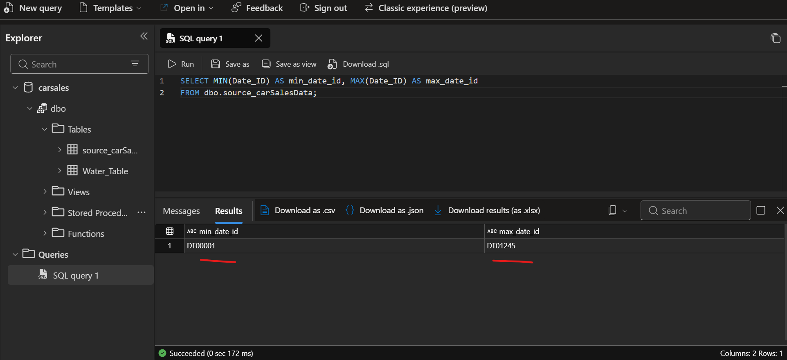

Since the minimum Date_ID is `DT00001`, the initial
watermark is set to `DT00000`, which is smaller than
all existing Date_ID values.

```sql
INSERT INTO dbo.Water_Table
VALUES ('DT00000');
```

`DT00000` is a sentinel value rather than an actual
business identifier.

During the first pipeline execution, the extraction
condition becomes:

```sql
WHERE Date_ID > 'DT00000'
  AND Date_ID <= 'DT01245'
```

This allows all 1,849 existing records to be selected
for the initial load.

```text
DT00000       DT00001                     DT01245
   |             |---------------------------|
Initial         MIN                         MAX
Watermark        All existing source records
```

#### Why This Design?

The same watermark-based pipeline supports both
initial full loading and subsequent incremental loading.

- First run: DT00000 allows all existing records to be extracted.
- After successful Copy: the stored procedure saves DT01245.
- Next run: DT01245 becomes the lower extraction boundary.
- Subsequent runs: only records within the new watermark
  boundaries are extracted.

This eliminates the need for separate full-load and
incremental-load extraction logic when starting with
an empty destination.

### 7.3 Validate (smoke test)

```sql
-- Delta row count using DT00000
SELECT COUNT(*) FROM source_carSalesData WHERE Date_ID > 'DT00000';

-- Full table row count
SELECT COUNT(*) FROM source_carSalesData;
```

**Expected: both numbers are equal** (because `DT00000` is smaller than any
real `Date_ID`, so the whole table is read as "delta").

### 7.4 Stored procedure: update the watermark

```sql
CREATE PROCEDURE UpdateWatermarkTable
     @new_watermark VARCHAR(200)
AS 
BEGIN
     -- start the transaction
     BEGIN TRANSACTION;

     UPDATE Water_Table
     SET Last_Load = @new_watermark;

     COMMIT TRANSACTION;
END;
```

**What it does:** updates `Water_Table.Last_Load` to the value passed in.

Call it like this:

```sql
EXEC UpdateWatermarkTable @new_watermark = 'DT00130';
```

> Note: A single `UPDATE` is already atomic in SQL Server.
> The `BEGIN TRANSACTION / COMMIT` wrapper here is decorative — it does not add
> any real safety in this specific case.

### 7.5 The full incremental flow (conceptual)

```
① Read watermark:   SELECT Last_Load FROM Water_Table;     → 'DT00119'
② Fetch delta:      SELECT * FROM source_carSalesData
                    WHERE Date_ID > 'DT00119' AND Date_ID <= 'DT00130';
③ Process the data
④ Update watermark: EXEC UpdateWatermarkTable @new_watermark = 'DT00130';
⑤ Next run starts from DT00130
```

---

### 7.6 Stored Procedure and Boundary Conditions

ADF can execute SQL through Script activity as well as call stored procedures. This project uses a Stored Procedure activity to encapsulate the watermark update. A single SQL UPDATE is atomic, but the SQL update and ADLS write are not a single transaction.

Use `old_watermark < Date_ID <= new_watermark` to include the maximum row. The original notes used a strict upper bound, which can skip rows at the maximum when the watermark advances. Initialize from `DT00000` only when the incremental destination is empty; otherwise initialize from the verified baseline maximum.

### 7.7 Watermark Column Selection — Date_ID vs Timestamp

A watermark does not necessarily have to be a timestamp.
It can be any column that reliably represents the progress
of data ingestion or modification.

| Watermark Column | Example | Purpose |
| :--- | :--- | :--- |
| `created_at` | 2026-11-25 10:00:00 | Track newly created records |
| `updated_at` | 2026-11-25 12:00:00 | Track inserted or updated records |
| `ingested_at` | 2026-11-25 14:00:00 | Track newly ingested records |
| `sequence_id` | 1849 | Track increasing sequence values |
| `Date_ID` | DT01245 | Track increasing source identifiers |

In this project, `Date_ID` is used as the watermark column
instead of a conventional timestamp.

The source dataset contains fixed-width identifiers such as:

```text
DT00001
DT00002
DT00003
...
DT01245
```

Because the numeric portion is consistently zero-padded,
lexicographical ordering follows the numeric identifier order.

This allows SQL Server to perform comparisons such as:

```sql
SELECT *
FROM dbo.source_carSalesData
WHERE Date_ID > 'DT01245';
```

The underlying concept is the same as timestamp-based
incremental processing used in dbt.

#### Important Limitation

`Date_ID` is not a unique row identifier, and multiple
records may share the same value.

It is also not necessarily a chronological representation
of the actual business date.

The watermark design therefore assumes that newly arriving
records have a Date_ID greater than the previously
processed watermark.

Late-arriving records with an older or identical Date_ID,
updates to existing records, and source deletions are not
automatically captured by this approach.

For production workloads, an appropriate modification
timestamp, composite watermark, or CDC mechanism may
provide more reliable change detection.

## 8. ADF Incremental Pipeline

### 8.1 Actual Pipeline (Author's Implementation)

The screenshot below shows the actual pipeline in Azure Data Factory:

Screenshot to capture: `assets/store_procedure.png`.

**ADF Watermark Incremental Load Pipeline**


The pipeline has four activities:

| Activity | Type | Purpose |
| :--- | :--- | :--- |
| `last_load` | Lookup | Read the current watermark from `Water_Table` |
| `current_load` | Lookup | Read `MAX(Date_ID)` from the source table |
| `Copy data1` | Copy | Copy rows with `last_load < Date_ID <= current_load` to the sink |
| `watermarkupdate` | Stored Procedure | Call `UpdateWatermarkTable` with the new watermark |

**Stored procedure settings:**

- **Linked service:** `AzureSqlDatabase1`
- **Stored procedure name:** `[dbo].[UpdateWatermarkTable]`
- **Parameter `new_watermark`:** `@activity('current_load').output.value[0].max_data`

**Execution order:**

```
last_load ──┐
            ├──► Copy data1 ──► watermarkupdate
current_load┘
```

- `last_load` and `current_load` run in parallel.
- `Copy data1` runs after both lookups finish.
- `watermarkupdate` runs after the copy succeeds.

---

### 8.2 Lookup Results and Independent Activity Validation

#### 8.2.1 Lookup Result — `last_load`

Before executing the complete incremental pipeline,
the `last_load` Lookup activity was tested independently
to verify that the initial watermark could be retrieved
from Azure SQL Database.

Source query:

```sql
SELECT Last_Load
FROM dbo.Water_Table;
```

Actual Lookup output (relevant fields):

```json
{
    "count": 1,
    "value": [
        {
            "Last_Load": "DT00000"
        }
    ]
}
```

**Execution Validation:**

| Validation Item | Result |
| :--- | :--- |
| Activity | last_load |
| Activity type | Lookup |
| Execution status | Succeeded |
| Rows returned | 1 |
| Retrieved watermark | DT00000 |
| Other activities | Inactive |
| Validation | Passed |

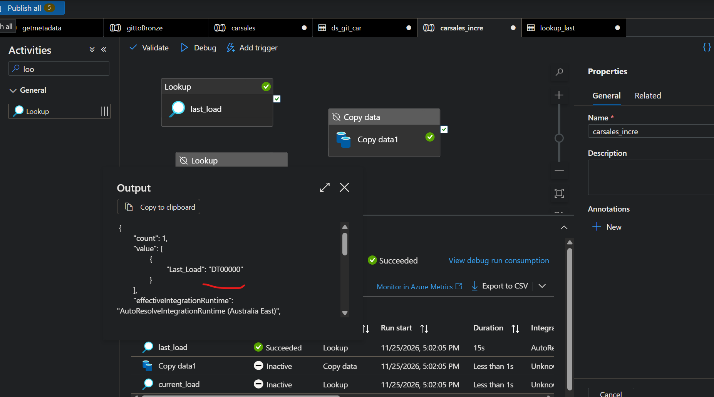

The initial watermark was successfully retrieved from
the SQL watermark table.

The returned value can be accessed in downstream
ADF activities using:

```text
@activity('last_load').output.value[0].Last_Load
```

This confirms that the lower extraction boundary
can be retrieved dynamically rather than hard-coded
in the Copy activity.

#### 8.2.2 Lookup Result — `current_load`

The `current_load` Lookup activity was tested independently
to verify that the maximum Date_ID could be retrieved
from the Azure SQL source table.

**Lookup configuration:**

- Source type: Query
- First row only: Unchecked

Source query:

```sql
SELECT MAX(Date_ID) AS max_data
FROM dbo.source_carSalesData;
```

Actual Lookup output (relevant fields):

```json
{
    "count": 1,
    "value": [
        {
            "max_data": "DT01245"
        }
    ]
}
```

**Execution Validation:**

| Validation Item | Result |
| :--- | :--- |
| Activity | current_load |
| Activity type | Lookup |
| Execution status | Succeeded |
| Rows returned | 1 |
| Maximum Date_ID | DT01245 |
| Execution duration | 6 seconds |
| Other activities | Inactive |
| Validation | Passed |

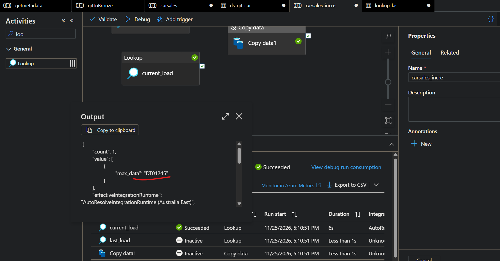

The maximum Date_ID was successfully retrieved from
the source table, establishing the upper boundary
for the current extraction window.

#### Understanding the Lookup JSON Output

The Lookup output contains a JSON array named `value`.

```text
output
  |
  +-- count: 1
  |
  +-- value (Array)
        |
        +-- [0] (First row)
              |
              +-- max_data (Key): DT01245 (Value)
```

| Component | Meaning |
| :--- | :--- |
| `output` | Complete activity output |
| `value` | Array containing the query results |
| `[0]` | Zero-based index of the first returned row |
| `max_data` | Column alias defined in the SQL query |
| `DT01245` | Actual value returned by the query |

The index `[0]` is used because JSON arrays are
zero-indexed, similar to Python lists.

The equivalent Python expression would be:

```python
output["value"][0]["max_data"]
```

In ADF, the dynamic expression is:

```text
@activity('current_load').output.value[0].max_data
```

Similarly, the previous watermark is retrieved using:

```text
@activity('last_load').output.value[0].Last_Load
```

#### Lookup Boundary Validation Summary

| Activity | SQL Source | Returned Value | Purpose |
| :--- | :--- | :--- | :--- |
| last_load | Water_Table.Last_Load | DT00000 | Lower boundary |
| current_load | MAX(Date_ID) | DT01245 | Upper boundary |

Both Lookup activities were independently executed
and successfully validated.

The next step is to pass these two values into
the Copy activity's parameterized SQL query.

#### 8.3.1 Dynamic Query — Runtime Execution Validation

The Copy activity was successfully executed using
the dynamic watermark expressions from both Lookup
activities.

**Resolved SQL query at runtime:**

```sql
SELECT *
FROM source_carSalesData
WHERE Date_ID <= 'DT01245'
  AND Date_ID > 'DT00000';
```

The runtime input confirms that ADF successfully
evaluated both Lookup expressions and substituted
their actual values into the SQL query.

**Actual Copy Activity Output (relevant fields):**

```json
{
    "dataRead": 315608,
    "dataWritten": 66973,
    "filesWritten": 1,
    "sourcePeakConnections": 1,
    "sinkPeakConnections": 1,
    "rowsRead": 1849,
    "rowsCopied": 1849,
    "copyDuration": 13,
    "throughput": 63.122,
    "errors": []
}
```

**Execution Validation:**

| Validation Item | Actual Result |
| :--- | :--- |
| Source | Azure SQL Database |
| Destination | Azure Data Lake Storage Gen2 |
| Lower watermark | DT00000 |
| Upper watermark | DT01245 |
| Rows read | 1,849 |
| Rows copied | 1,849 |
| Files written | 1 |
| Data read | 315,608 bytes |
| Data written | 66,973 bytes |
| Copy duration | 13 seconds |
| Execution status | Succeeded |
| Errors | None |

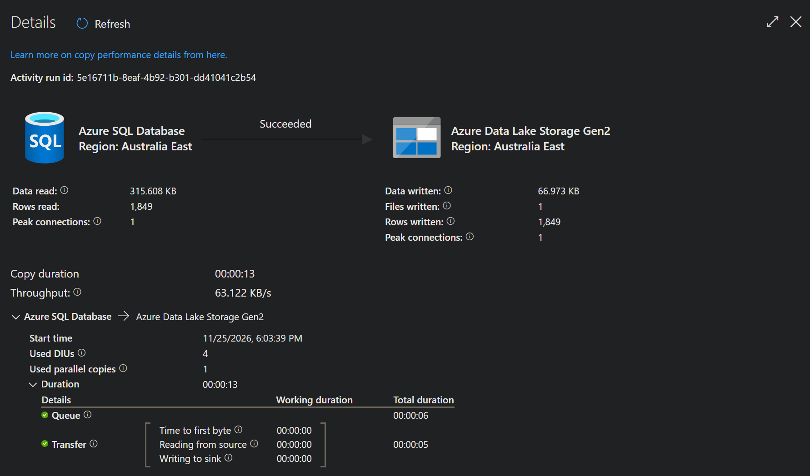

The number of rows copied matches the initial source
record count of 1,849.

#### ADLS Sink Verification

The generated output file was verified directly
in Azure Data Lake Storage Gen2.

| Item | Result |
| :--- | :--- |
| Container | bronze |
| Directory | rawdata |
| File format | Parquet |
| Files generated | 1 |
| File size | 65.4 KiB |

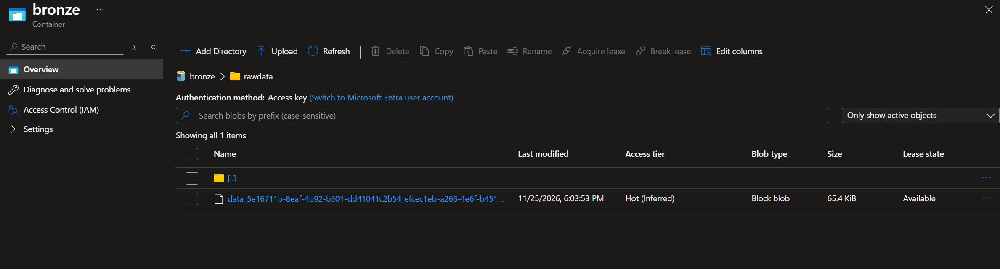

#### Troubleshooting — Design-Time vs Runtime Expression Resolution

During development, both Preview Data and Import Schemas
failed when the source query referenced dynamic Lookup
expressions.

Error code:

```text
FailToResolveParametersInExploratoryController
```

Error details:

```text
property 'value' doesn't exist,
available properties are 'value[0]'
```

However, the equivalent static SQL query could be
previewed successfully.

| Validation | Result |
| :--- | :--- |
| last_load Lookup | Passed |
| current_load Lookup | Passed |
| Static SQL Preview | Passed |
| Dynamic SQL Preview | Failed |
| Dynamic Import Schemas | Failed |
| Runtime Expression Resolution | Passed |
| Copy Activity Execution | Passed |
| ADLS File Generation | Passed |

The original dynamic expressions were retained:

```text
@activity('current_load').output.value[0].max_data
@activity('last_load').output.value[0].Last_Load
```

The successful runtime execution confirmed that the
Lookup expressions were valid despite the design-time
resolution errors.

This demonstrates the importance of distinguishing
design-time validation from actual pipeline execution.

The initial watermark-based extraction has been
successfully validated. Watermark persistence and
subsequent incremental execution require separate
validation.

### 8.4 Stored Procedure — Parameter Passing and Watermark Update

The Stored Procedure activity passes the new watermark into
`UpdateWatermarkTable`.

#### ADF Parameter Configuration

| Parameter | Dynamic Value |
| :--- | :--- |
| `new_watermark` | `@activity('current_load').output.value[0].max_data` |

As shown in Section 8.1, the Stored Procedure activity
is connected to the Copy activity through an On Success
dependency.

The `new_watermark` parameter receives the maximum
Date_ID dynamically from the `current_load` Lookup.

This ensures that the watermark update is triggered
only after the Copy activity succeeds.

The expression resolves at runtime to:

```text
DT01245
```

ADF effectively executes:

```sql
EXEC dbo.UpdateWatermarkTable
    @new_watermark = 'DT01245';
```

Inside the stored procedure:

```sql
UPDATE dbo.Water_Table
SET Last_Load = @new_watermark;
```

#### Parameter Passing Flow

```text
ADF: current_load Lookup
    MAX(Date_ID) = DT01245
            |
            v
ADF: Stored Procedure Activity
    @new_watermark = DT01245
            |
            v
SQL: UpdateWatermarkTable
    SET Last_Load = @new_watermark
            |
            v
SQL: Water_Table
    DT00000 --> DT01245
            |
            v
Next Pipeline Run: last_load Lookup
    SELECT Last_Load FROM Water_Table
    Returns DT01245
```

#### Understanding the Three Variables

| Name | Location | Responsibility |
| :--- | :--- | :--- |
| `current_load` | ADF Lookup activity | Retrieve the current source maximum |
| `@new_watermark` | Stored Procedure parameter | Receive the new watermark from ADF |
| `Last_Load` | SQL watermark table column | Persist the last successfully processed position |

SQL Server does not directly reference the ADF activity
named `current_load`. ADF evaluates the dynamic expression
and passes its result into the stored procedure parameter.

#### Design Improvement — Parameter Naming

The original implementation uses `@lastload` as the
stored procedure parameter.

This project renames it to `@new_watermark` to clearly
distinguish the incoming watermark from the previously
stored `Last_Load` value.

```sql
SET Last_Load = @new_watermark;
```

This refactoring improves readability and maintainability
without changing the underlying incremental load logic.

#### State Management

Lookup outputs are temporary values available during
the current pipeline execution.

The watermark table provides persistent state across
independent pipeline runs.

The stored procedure is responsible for persisting
the new watermark only after the Copy activity succeeds.

**Core principle:**

```text
Current Run                         Next Run

current_load --> Stored Procedure --> last_load
                     |
                     v
                 Water_Table
              (Persistent State)
```

The current watermark of a successful pipeline run
becomes the previous watermark of the next run.

### 8.5 Why `.value[0]` and not `.firstRow`

This depends on a checkbox inside the Lookup activity:

| "First row only" | Output shape | Path |
| :--- | :--- | :--- |
| ✅ Checked | `{ "firstRow": { "col": ... } }` | `.output.firstRow.col` |
| ❌ Unchecked | `{ "value": [ { "col": ... } ] }` | `.output.value[0].col` |

The example in 8.2 is the unchecked form (`value` array), so `.value[0]`
is required. If the Lookup is later changed to "First row only",
all downstream expressions must switch to `.firstRow`.

### 8.6 Summary Table

| Piece | Source | Value / Expression |
| :--- | :--- | :--- |
| File selection | Dataset parameter | `@{dataset().load_flag}` (Section 5) |
| Lookup result | `current_load` activity | `{ "value": [ { "max_data": "DT01245" } ] }` |
| Copy data SQL | Copy activity source query | `WHERE Date_ID <= @{...current_load...} AND Date_ID > @{...last_load...}` |
| Stored proc value | `current_load` output | `@activity('current_load').output.value[0].max_data` |

---

### 8.7 No-change handling

Optionally add an If Condition after both Lookups to skip Copy and watermark update when the source maximum is NULL or not greater than the old watermark. Configure pipeline concurrency to prevent overlapping runs. Only advance the watermark on successful Copy.

### 8.8 Why Two Lookup Activities? — Watermark Boundaries

The incremental pipeline uses two Lookup activities to
establish a bounded extraction window.

- `last_load`: Where did the previous successful load stop?
- `current_load`: Where should the current load stop?

#### Step 1 — Read the Previous Watermark

```sql
SELECT Last_Load
FROM dbo.Water_Table;
```

Example result:

```text
DT00000
```

This represents the lower boundary of the current extraction.

#### Step 2 — Capture the Current Source Boundary

```sql
SELECT MAX(Date_ID) AS max_data
FROM dbo.source_carSalesData;
```

Example result:

```text
DT01245
```

This represents the upper boundary of the current extraction.

#### Step 3 — Extract the Bounded Data Range

```sql
SELECT *
FROM dbo.source_carSalesData
WHERE Date_ID > 'DT00000'
  AND Date_ID <= 'DT01245';
```

The extraction window is:

```text
(last_load, current_load]

DT00000                          DT01245
   |--------------------------------|
   Excluded       Included       Included
```

The lower boundary is exclusive, while the upper boundary
is inclusive.

This ensures that records at the current upper boundary
are included before the watermark advances.

#### Step 4 — Advance the Watermark

Only after the Copy activity succeeds, execute:

```sql
EXEC dbo.UpdateWatermarkTable
    @new_watermark = 'DT01245';
```

The next pipeline execution starts from the newly
recorded watermark.

#### Execution Flow

```text
Lookup: last_load        Lookup: current_load
   DT00000                   DT01245
       |                         |
       +------------+------------+
                    |
                    v
              Copy Activity
       Date_ID > last_load
       Date_ID <= current_load
                    |
                    | On Success
                    v
           Stored Procedure
          UpdateWatermarkTable
                    |
                    v
        Watermark = DT01245
```

#### Example — Three Consecutive Pipeline Runs

The following example illustrates the expected behavior
using the initial dataset of 1,849 records and a
hypothetical incremental batch of four records.

| Execution | Run 1 | Run 2 | Run 3 |
| :--- | :--- | :--- | :--- |
| Scenario | Initial Load | No New Data | Incremental Load |
| Previous watermark | DT00000 | DT01245 | DT01245 |
| Current source maximum | DT01245 | DT01245 | DT01247 |
| Expected rows copied | 1,849 | 0 | 4 |
| Updated watermark | DT01245 | DT01245 | DT01247 |

The first execution behaves as a full load because
the initial watermark is lower than all existing Date_ID
values.

Subsequent executions extract only records within the
new watermark boundaries.

#### Why Capture the Upper Boundary Before Copying?

Consider a scenario where new records arrive while
the Copy activity is running.

```text
Before Copy:
    MAX(Date_ID) = DT01245

During Copy:
    New records arrive up to DT01250

After Copy:
    MAX(Date_ID) = DT01250
```

If the pipeline reads the latest maximum only after
the Copy activity completes, it may advance the watermark
to DT01250 even though some of those records were not copied.

Those records could then be skipped in the next execution.

By capturing the upper boundary before extraction, both
the Copy activity and Stored Procedure use the same
watermark value.

```text
Current execution:
    Copy records up to DT01245
    Update watermark to DT01245

Next execution:
    Copy records greater than DT01245
```

This establishes a consistent logical extraction boundary.

However, it does not provide full transactional snapshot
isolation across the Lookup and Copy activities.

Late-arriving records within an already processed range
still require additional handling.

#### ADF Watermark vs dbt Incremental Processing

In previous dbt projects, incremental processing was
implemented using timestamp-based filtering:

```sql


WHERE updated_at > (
    SELECT MAX(updated_at)
    FROM {{ this }}
)


```

In this ADF project, the equivalent filtering concept is:

```sql
WHERE Date_ID > last_load
  AND Date_ID <= current_load
```

| Aspect | dbt Incremental | ADF Watermark |
| :--- | :--- | :--- |
| Processing stage | Data transformation | Source data extraction |
| Watermark storage | Target table | Dedicated watermark table |
| Previous boundary | MAX(updated_at) | Lookup: last_load |
| Current boundary | Not explicitly defined in this example | Lookup: current_load |
| Filtering mechanism | SQL WHERE clause | Parameterized SQL WHERE clause |
| Progress advancement | Successful target materialization | Stored Procedure |
| Example watermark | Timestamp | Date_ID |
| Target operation | MERGE / INSERT | Copy Activity |

Both approaches follow the same fundamental principle:

1. Identify the previously processed position.
2. Select the unprocessed data.
3. Process the selected records.
4. Advance the processing position after success.

The main difference is how the watermark is stored,
retrieved, and advanced.

ADF explicitly manages the extraction state through
Lookup activities and a dedicated control table.

The dbt example derives the processing state from the
existing target table.

#### Key Takeaway

> Lookup 1 determines where to start.
>
> Lookup 2 determines where to stop.
>
> Copy Activity processes the bounded data range.
>
> Stored Procedure records the successfully processed boundary.

## 9. Incremental Load Validation

The watermark-based incremental pipeline was validated
through three consecutive execution scenarios:

1. Initial load — extract all existing source records.
2. No-change run — verify that previously processed records
   are not extracted again.
3. Incremental load — introduce new source records and
   verify that only newly available data is extracted.

All three scenarios were successfully validated on
25 November 2026.

The validation covers both data movement from Azure SQL
to ADLS Gen2 and watermark persistence in Azure SQL.

---

### 9.1 Initial Load — Full Pipeline Execution

The initial watermark-based extraction was successfully
validated in Section 8.3.1.

All 1,849 source records were transferred from Azure SQL
to ADLS Gen2 using the extraction window
(DT00000, DT01245].

This establishes the baseline for subsequent watermark
persistence, no-change and incremental load validation.

---

### 9.2 Watermark Persistence Validation

After the Copy activity succeeded, the Stored Procedure
activity received the current watermark through its
input parameter.

```text
@activity('current_load').output.value[0].max_data
```

The resolved parameter value was:

```text
@new_watermark = DT01245
```

The stored procedure updated the watermark control table
using the following SQL statement:

```sql
UPDATE dbo.Water_Table
SET Last_Load = @new_watermark;
```

The persisted watermark was then verified directly
in Azure SQL:

```sql
SELECT *
FROM dbo.Water_Table;
```

**Actual Validation Results:**

| Validation Item | Result |
| :--- | :--- |
| Previous watermark | DT00000 |
| Current source maximum | DT01245 |
| Stored procedure parameter | DT01245 |
| Persisted watermark | DT01245 |
| Watermark persistence | Passed |

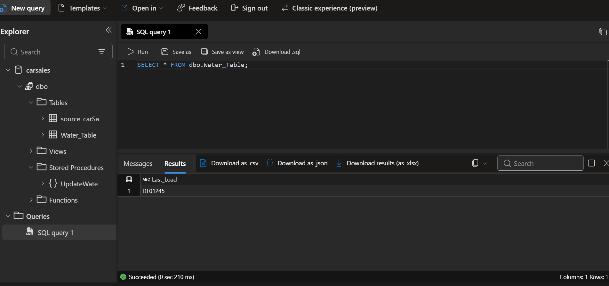

The watermark was successfully updated from `DT00000`
to `DT01245`.

The complete parameter-passing mechanism is illustrated
below:

```text
current_load Lookup
        |
        v
max_data = DT01245
        |
        v
Stored Procedure Parameter
@new_watermark = DT01245
        |
        v
UPDATE Water_Table
SET Last_Load = @new_watermark
        |
        v
Persisted Last_Load = DT01245
        |
        v
Next Pipeline Execution
last_load = DT01245
```

This confirms that the current extraction boundary
becomes the previous extraction boundary for the next
pipeline execution.

The watermark is persisted independently of the
pipeline execution itself, allowing subsequent runs
to resume from the last successfully recorded
extraction boundary.

---

### 9.3 No-change Run Validation

The pipeline was executed a second time without
introducing new source data, resetting the watermark,
or deleting the existing ADLS output file.

Both Lookup activities were expected to return the
same watermark value:

| Lookup Activity | Value |
| :--- | :--- |
| last_load | DT01245 |
| current_load | DT01245 |

The resulting extraction query was equivalent to:

```sql
SELECT *
FROM dbo.source_carSalesData
WHERE Date_ID <= 'DT01245'
  AND Date_ID > 'DT01245';
```

Because the lower and upper extraction boundaries
were identical, no records qualified for extraction.

**Actual Execution Results:**

| Validation Item | Result |
| :--- | :--- |
| Rows read | 0 |
| Rows copied | 0 |
| Data read | 0 bytes |
| Data written | 416 bytes |
| Files written | 1 |
| Copy duration | 15 seconds |
| Persisted watermark | DT01245 (unchanged) |
| Duplicate row extraction | None |
| Execution status | Succeeded |
| No-change validation | Passed |

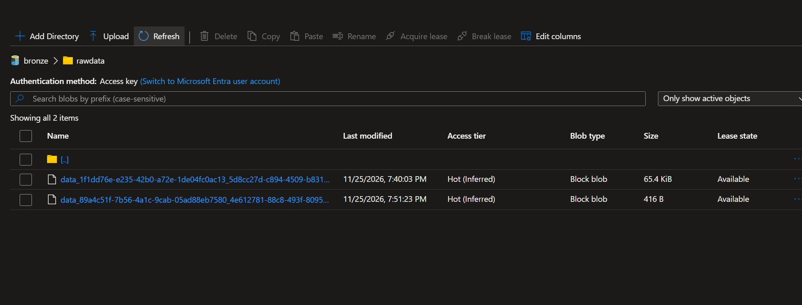

The watermark table was queried again after the second
execution:

```sql
SELECT *
FROM dbo.Water_Table;
```

The persisted watermark remained `DT01245`, confirming
that the extraction boundary did not advance when
no new source records were available.

#### ADLS Sink Verification

The ADLS destination was inspected after the second
pipeline execution.

| Pipeline Run | File Size | Data Rows |
| :--- | ---: | ---: |
| Initial load | 65.4 KiB | 1,849 |
| No-change run | 416 bytes | 0 |


The original data file remained present, while the
second execution generated an empty Parquet file.

The 416-byte file contains no data rows. Its size
reflects the Parquet file structure and metadata.

This confirms that the watermark mechanism prevents
previously processed records from being extracted
again when the source remains unchanged.

#### Idempotency Consideration

The no-change execution validates row-level
idempotency under normal execution conditions.

However, the pipeline is not fully idempotent at
the file level because an additional empty Parquet
file is generated during the second execution.

A future improvement would be to introduce an
If Condition activity that compares the previous
and current watermark values before executing
the Copy activity.

Failure recovery and retry-safe file-level
idempotency require separate validation.

---

### 9.4 Incremental Load — New Data Validation

To validate genuine incremental extraction,
a second source file, `IncrementalSales.csv`,
was introduced into Azure SQL.

The existing parameterized GitHub-to-Azure-SQL
ingestion pipeline was reused.

#### 9.4.1 Incremental Source Ingestion

The dataset parameter was changed from the initial
source file to the incremental source file.

| Configuration | Initial Load | Incremental Load |
| :--- | :--- | :--- |
| Dataset parameter | load_flag | load_flag |
| Source file | SalesData.csv | IncrementalSales.csv |
| Target table | dbo.source_carSalesData | dbo.source_carSalesData |
| Write behavior | Insert | Insert |

The incremental source file contained four new
sales records.

| Date_ID | Number of Records |
| :--- | ---: |
| DT01246 | 2 |
| DT01247 | 2 |
| Total | 4 |

The Insert write behavior was used to append the
new records to the existing Azure SQL source table
without replacing the original records.

After ingestion, the source table was validated
using the following SQL query:

```sql
SELECT
    COUNT(*) AS total_rows,
    MAX(Date_ID) AS max_date_id
FROM dbo.source_carSalesData;
```

**Actual Source Validation Results:**

| Validation Item | Before Ingestion | After Ingestion |
| :--- | :--- | :--- |
| Total source rows | 1,849 | 1,853 |
| Maximum Date_ID | DT01245 | DT01247 |
| Newly inserted rows | — | 4 |

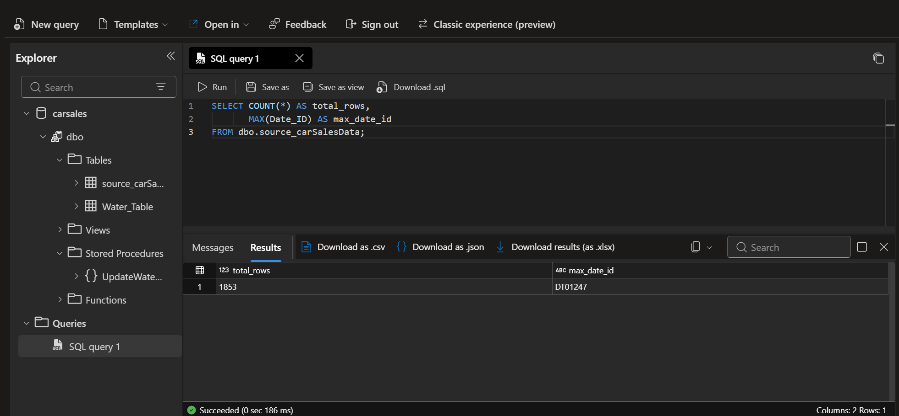

At this stage, the source table contained 1,853
records, while the persisted watermark from the
previous extraction remained `DT01245`.

This created a new extraction window for the
watermark-based pipeline.

The GitHub-to-Azure-SQL ingestion pipeline was
executed once for the incremental source file.

Repeated execution of the Insert operation could
introduce duplicate source records because this
ingestion pipeline does not implement deduplication.

#### 9.4.2 Dynamic Incremental Extraction

The Azure SQL-to-ADLS pipeline was executed again
without modifying its existing configuration,
dynamic SQL expressions, or stored procedure.

The extraction boundaries were:

| Lookup Activity | Value |
| :--- | :--- |
| last_load | DT01245 |
| current_load | DT01247 |

The resulting extraction query was equivalent to:

```sql
SELECT *
FROM dbo.source_carSalesData
WHERE Date_ID <= 'DT01247'
  AND Date_ID > 'DT01245';
```

The query excludes previously processed records
and includes all records within the new extraction
window.

```text
Previously processed records       New records

DT00001 ............ DT01245       DT01246  DT01247
|__________________________|       |_____________|
          Excluded                      Included

                       Old watermark: DT01245
                       New watermark: DT01247
```

The lower boundary is exclusive, while the upper
boundary is inclusive.

This ensures that records matching the current
maximum Date_ID are included before the watermark
is advanced.

**Actual Execution Results:**

| Validation Item | Result |
| :--- | :--- |
| Total source rows | 1,853 |
| Previous watermark | DT01245 |
| Current watermark | DT01247 |
| Rows read | 4 |
| Rows copied | 4 |
| Data read | 686 bytes |
| Data written | 2.658 KB |
| Files written | 1 |
| Copy duration | 14 seconds |
| Execution status | Succeeded |
| Incremental extraction | Passed |

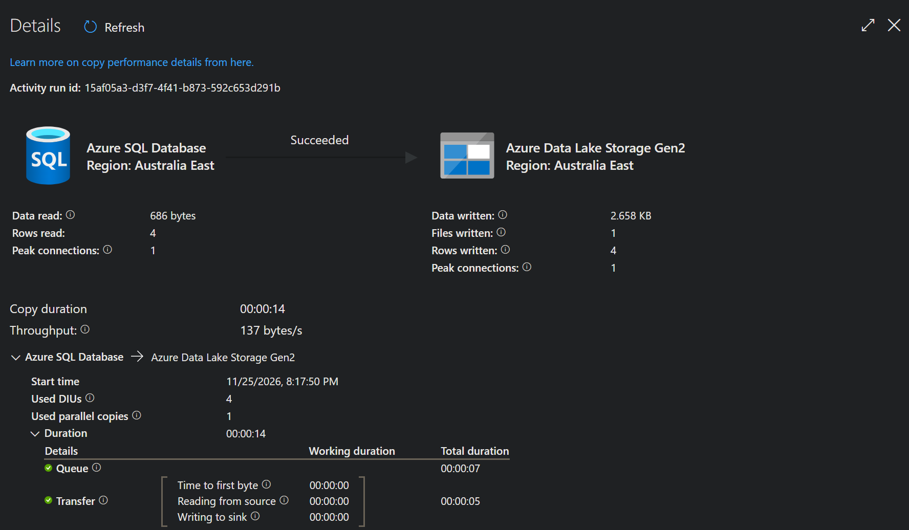

Only four newly available records were extracted
from the source table containing 1,853 records.

The original 1,849 records were not extracted again.

This confirms that the extraction window dynamically
adapts to changes in the source data without requiring
manual modification of the pipeline query.

#### 9.4.3 Incremental Watermark Update

After the incremental Copy activity succeeded,
the Stored Procedure activity received the new
maximum Date_ID through its input parameter.

```text
current_load.max_data = DT01247
        |
        v
@new_watermark = DT01247
        |
        v
Water_Table.Last_Load = DT01247
```

The persisted watermark was verified directly
in Azure SQL:

```sql
SELECT *
FROM dbo.Water_Table;
```

**Actual Validation Results:**

| Validation Item | Result |
| :--- | :--- |
| Previous watermark | DT01245 |
| Current source maximum | DT01247 |
| Persisted watermark | DT01247 |
| Watermark update | Passed |

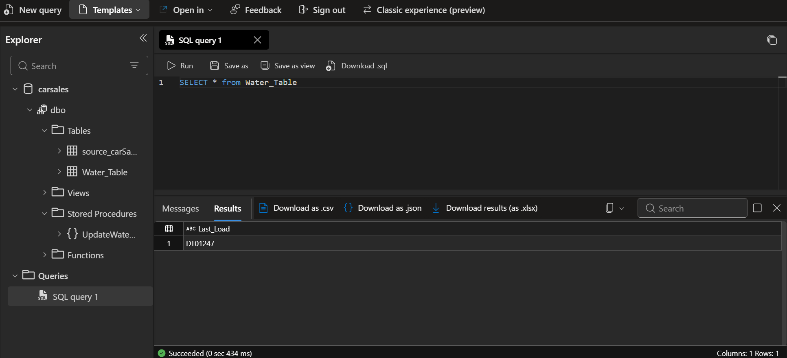

The watermark was successfully advanced from
`DT01245` to `DT01247`.

The next pipeline execution will therefore use
`DT01247` as its lower extraction boundary.

#### 9.4.4 ADLS Incremental Output Verification

The ADLS destination was inspected after the
third pipeline execution.

Three output files were present in the
`bronze/rawdata` directory.

| Pipeline Run | File Size | Data Rows |
| :--- | ---: | ---: |
| Run 1 — Initial load | 65.4 KiB | 1,849 |
| Run 2 — No-change run | 416 bytes | 0 |
| Run 3 — Incremental load | 2.6 KiB | 4 |
| Total | 3 files | 1,853 |

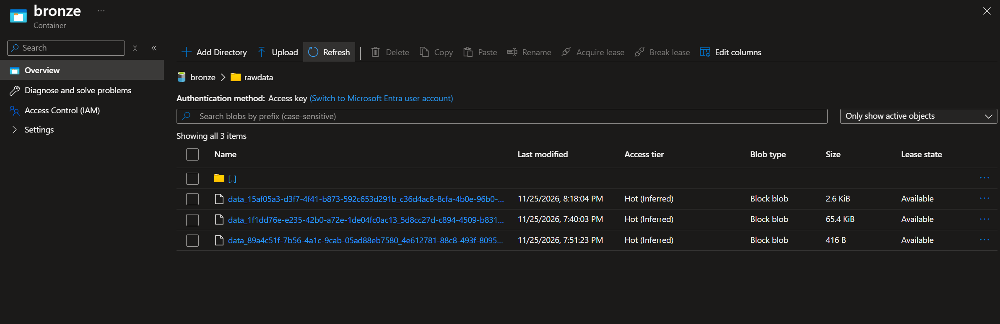

The third execution generated a separate Parquet
file corresponding to the four newly extracted
records.

The original initial-load file and the empty
no-change file remained present in ADLS.

Based on the ADF execution metrics, the cumulative
number of rows written to ADLS was:

```text
1,849 + 0 + 4 = 1,853 rows
```

This matches the total number of records in the
Azure SQL source table after incremental ingestion.

The actual Parquet contents will be independently
validated during the Databricks Bronze ingestion
stage.

---

### 9.5 Validation Summary

The watermark-based pipeline was successfully
validated across three consecutive execution
scenarios.

| Validation Item | Run 1 | Run 2 | Run 3 |
| :--- | :--- | :--- | :--- |
| Load type | Initial | No-change | Incremental |
| Source rows | 1,849 | 1,849 | 1,853 |
| Previous watermark | DT00000 | DT01245 | DT01245 |
| Current watermark | DT01245 | DT01245 | DT01247 |
| Rows read | 1,849 | 0 | 4 |
| Rows copied | 1,849 | 0 | 4 |
| Persisted watermark | DT01245 | DT01245 | DT01247 |
| Output file size | 65.4 KiB | 416 B | 2.6 KiB |
| Files written | 1 | 1 | 1 |
| Copy duration | 13s | 15s | 14s |
| Validation status | Passed | Passed | Passed |

#### Watermark Lifecycle

```text
Initial Watermark
DT00000
    |
    v
Run 1 — Initial Load
Extract 1,849 rows
DT00000 -> DT01245
    |
    v
Run 2 — No-change Run
Extract 0 rows
DT01245 -> DT01245
    |
    v
New Source Data Introduced
Insert 4 records into Azure SQL
Source total: 1,853 rows
    |
    v
Run 3 — Incremental Load
Extract 4 rows
DT01245 -> DT01247
    |
    v
Persisted Watermark
DT01247
    |
    v
Ready for Next Incremental Execution
```

#### Functional Validation Checklist

- [x] Initial watermark initialization
- [x] Previous watermark retrieval
- [x] Current source watermark retrieval
- [x] Dynamic SQL expression resolution at runtime
- [x] Initial full data extraction
- [x] Azure SQL-to-ADLS data movement
- [x] Stored procedure parameter passing
- [x] Watermark persistence
- [x] No-change execution validation
- [x] Prevention of repeated row extraction during no-change runs
- [x] Parameterized incremental source ingestion
- [x] Incremental extraction of newly available records
- [x] Automatic advancement of the persisted watermark
- [x] ADLS output file verification
- [x] Source-to-sink row-count reconciliation using ADF metrics

#### Validation Conclusion

The three execution scenarios demonstrate that
the implemented watermark mechanism successfully
supports stateful incremental data extraction
from Azure SQL to ADLS Gen2.

The pipeline dynamically determines the extraction
window using two Lookup activities, transfers
qualifying records through the Copy activity,
and persists the new extraction boundary through
a stored procedure after successful data movement.

No manual watermark updates or modifications to
the incremental extraction query were required
between the three validated executions.

The pipeline demonstrates the following data
engineering concepts:

- Stateful incremental ingestion
- Watermark-based extraction
- Dynamic SQL generation
- Parameterized source ingestion
- Activity dependency management
- Persistent pipeline state
- No-change execution validation
- Source-to-sink row-count reconciliation

The validation establishes functional correctness
under the tested sequential execution scenarios.

Production-level considerations, including
non-unique watermark values, late-arriving records,
source deduplication, empty file generation,
concurrent execution, and failure recovery,
are discussed separately in Section 15.

The ADLS output is now ready for the downstream
Databricks Bronze ingestion stage.

---

## 10. Databricks Bronze Layer

The Bronze layer ingests Parquet files from ADLS Gen2 into a Databricks managed Delta table.

As this project uses Databricks Free Edition without an External Location, a custom ingestion mechanism is implemented using the Azure Blob Storage SDK, Pandas and PySpark.

### 10.1 ADLS Connection and File Discovery

Install the required Azure Storage SDK in a Databricks notebook:

```python
%pip install azure-storage-blob
```

Restart the Python environment if required:

```python
dbutils.library.restartPython()
```

Generate a container-level SAS token in Azure Portal with the following permissions:

- Read
- List

Connect to the Bronze container and dynamically discover files under `rawdata/`.

```python
from azure.storage.blob import ContainerClient

account_url = "https://<storage_account>.blob.core.windows.net"
container_name = "bronze"
sas_token = "<your_container_sas_token>"

container_client = ContainerClient(
    account_url=account_url,
    container_name=container_name,
    credential=sas_token
)

for blob in container_client.list_blobs(
    name_starts_with="rawdata/"
):
    print(blob.name, blob.size)
```

**Security Note:** Use the SAS token rather than the complete SAS URL. Never commit actual SAS credentials to GitHub.

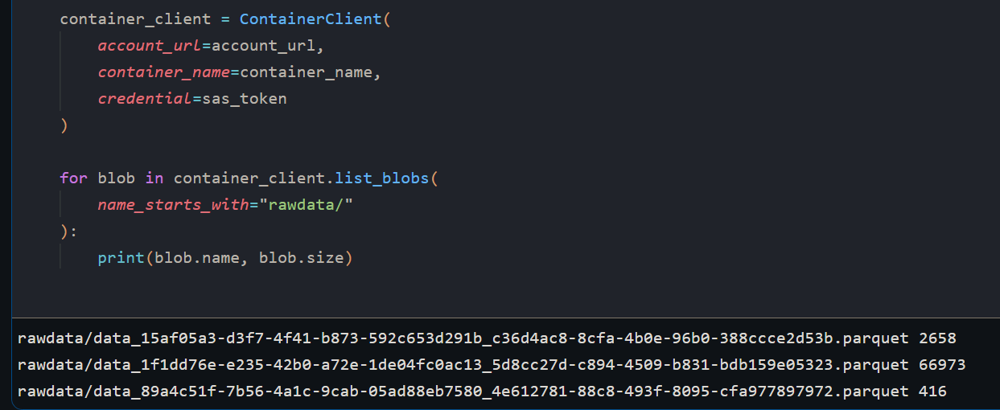

The container-level SAS token allows newly generated Parquet files to be discovered without creating individual SAS URLs.

### 10.2 Incremental Bronze Delta Ingestion

Create a managed Delta table using Pandas and PySpark.

**Target Table:** `cars_catalog.bronze.rawdata`

The target catalog and schema must exist before executing the ingestion notebook.

The ingestion process includes:

- Dynamic Parquet file discovery.
- File-level incremental processing.
- Empty Parquet file handling.
- Pandas-to-Spark DataFrame conversion.
- Ingestion metadata enrichment.
- Managed Delta table creation and append operations.

```python
import pandas as pd
from io import BytesIO
from pyspark.sql.functions import current_timestamp, lit

target_table = "cars_catalog.bronze.rawdata"

# Identify previously ingested files
processed_files = set()

if spark.catalog.tableExists(target_table):
    processed_files = {
        row.source_file
        for row in spark.table(target_table)
        .select("source_file")
        .distinct()
        .collect()
    }

# Discover and ingest new Parquet files
for blob in container_client.list_blobs(
    name_starts_with="rawdata/"
):
    if not blob.name.endswith(".parquet"):
        continue

    if blob.name in processed_files:
        print(f"Already processed: {blob.name}")
        continue

    blob_client = container_client.get_blob_client(blob.name)

    data = blob_client.download_blob().readall()

    df = pd.read_parquet(BytesIO(data))

    if df.empty:
        print(f"Empty file skipped: {blob.name}")
        continue

    spark_df = spark.createDataFrame(df)

    spark_df = (
        spark_df
        .withColumn("source_file", lit(blob.name))
        .withColumn("ingested_at", current_timestamp())
    )

    # Write to managed Delta table
    spark_df.write \
        .format("delta") \
        .mode("append") \
        .saveAsTable(target_table)

    print(f"Ingested: {blob.name}, Rows: {len(df)}")
```

The managed Delta table is automatically created during the first successful write. Subsequent executions append records only from previously unprocessed files.

Two technical metadata columns are added:

| Column | Purpose |
|---|---|
| `source_file` | Data lineage and file-level ingestion tracking |
| `ingested_at` | Ingestion timestamp for downstream incremental processing |

### 10.3 Bronze Data Validation

Three Parquet files generated by the upstream ADF
pipeline were discovered and validated.

| Load Type | File Size | Row Count |
|---|---:|---:|
| Initial Load | 66,973 B | 1,849 |
| Incremental Load | 2,658 B | 4 |
| No-change Run | 416 B | 0 |
| **Total** | | **1,853** |

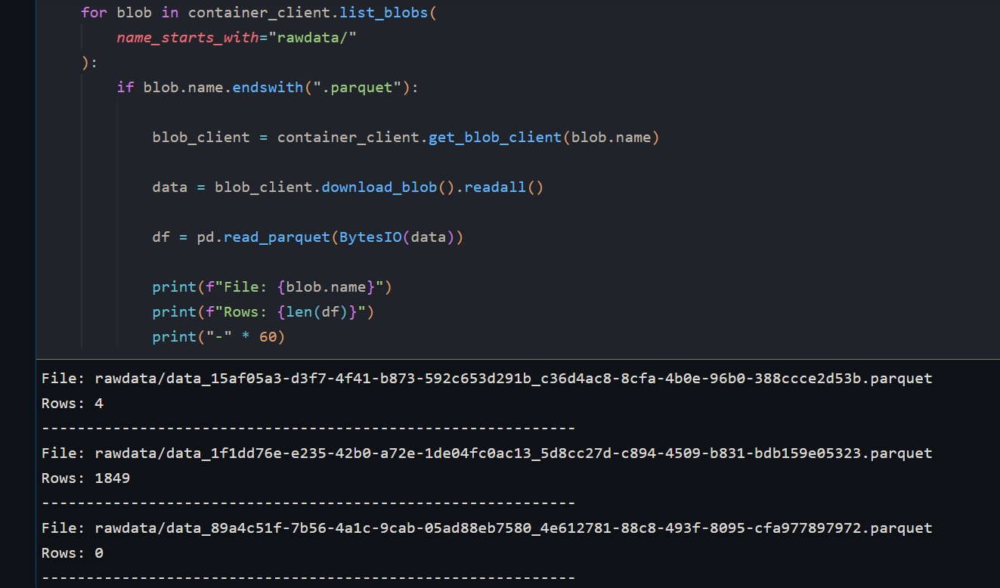

Validate the Bronze Delta table:

```sql
SELECT COUNT(*)
FROM cars_catalog.bronze.rawdata;
```

**Result: 1,853 rows**

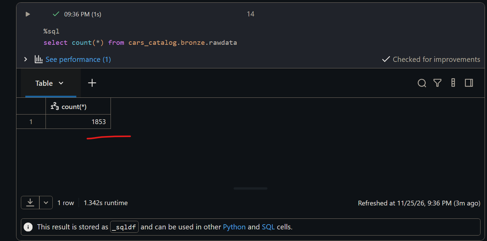

The Bronze row count matches the total number of records in the upstream Azure SQL source at the time of validation.

### 10.4 Idempotency Validation

The ingestion notebook was executed again without introducing new source files.

Previously ingested files were identified through the `source_file` column and skipped. The empty Parquet file was also skipped.

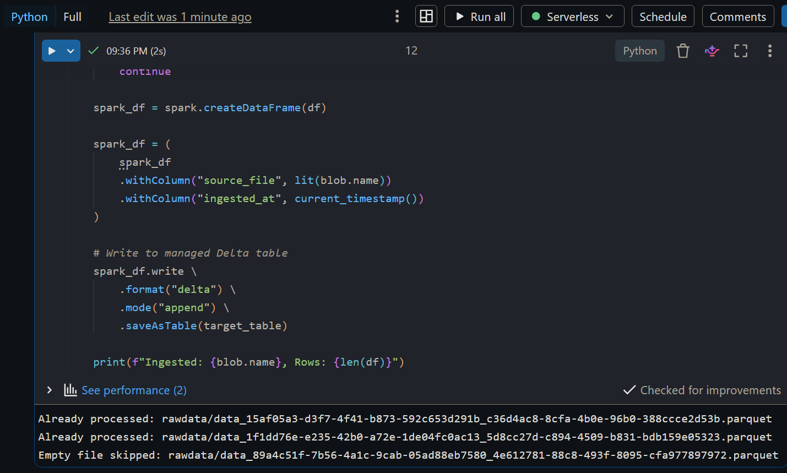

| Validation Scenario | Bronze Row Count |
|---|---:|
| First Execution | 1,853 |
| Repeated Execution | 1,853 |
| Additional Rows Introduced | 0 |

This confirms file-level idempotency under sequential execution with unchanged source files.

The append strategy preserves raw ingested records, while file-level tracking prevents previously ingested files from being appended again.

### 10.5 Design Summary

```text
ADLS Gen2 (Parquet)
        |
        v
Azure Blob Storage SDK
        |
        v
Pandas DataFrame
        |
        v
Spark DataFrame
        |
        v
Bronze Managed Delta Table
        |
        v
dbt Silver Layer
        |
        v
dbt Gold Star Schema
```

This implementation provides a lightweight alternative to Databricks Auto Loader for the current project.

**Design Considerations**

- Container-level SAS authentication eliminates the need for individual file SAS URLs.
- File-level incremental ingestion is implemented using the `source_file` metadata column rather than a separate ingestion log.
- Empty Parquet files are skipped but are checked again during subsequent executions.
- The implementation assumes immutable source files and sequential ingestion runs.
- Pandas-based in-memory processing is suitable for the current project scale but is not designed for large-scale distributed ingestion.

The Bronze layer preserves raw business data and ingestion metadata. All downstream data cleaning, business transformations, incremental models and dimensional modelling are implemented using dbt.

## 11. Silver — dbt Transformation

The Silver layer transforms the managed Bronze Delta table into a structured sales dataset using dbt SQL models.

Unlike the reference implementation, which performs Silver transformations using PySpark DataFrames, this project uses dbt to implement SQL-based transformations, dependency management and data quality testing.

### 11.1 Bronze Source Definition

Declare the managed Bronze Delta table as a dbt source.

`models/bronze/source.yml`:

```yaml
version: 2

sources:
  - name: bronze
    database: cars_catalog
    schema: bronze
    tables:
      - name: rawdata
```

The `source()` function establishes an explicit dependency between the Bronze source table and the Silver model.

```text
cars_catalog.bronze.rawdata
            |
            | dbt source()
            v
cars_catalog.silver.silver_car
```

### 11.2 Silver Transformation

`models/silver/silver_car.sql`:

```sql
{{ config(materialized='table', schema='silver') }}

select
    branch_id,
    dealer_id,
    model_id,
    revenue,
    units_sold,
    date_id,
    day,
    month,
    year,
    branchname,
    dealername,
    product_name,
    split(model_id, '-')[0] as model_category,
    round(revenue / nullif(units_sold, 0), 2) as revperunit,
    source_file,
    ingested_at,
    current_timestamp() as silver_loaded_at
from {{ source('bronze', 'rawdata') }}
```

The Silver model preserves all 12 original business columns and introduces two derived business fields and three technical metadata fields.

| Column | Transformation / Purpose |
|---|---|
| model_category | Extract the prefix from Model_ID |
| revperunit | Calculate revenue per unit sold |
| source_file | Preserve source file lineage |
| ingested_at | Preserve the Bronze ingestion timestamp |
| silver_loaded_at | Record the Silver transformation timestamp |

#### Model Category Transformation — PySpark vs dbt

The reference implementation uses PySpark:

```python
df = df.withColumn(
    "model_category",
    split(col("Model_ID"), "-")[0]
)
```

The equivalent dbt SQL transformation is:

```sql
split(model_id, '-')[0] as model_category
```

Both implementations extract the first component of the model identifier.

| Model_ID | model_category |
|---|---|
| Toy-M195 | Toy |
| Mah-M165 | Mah |
| Jee-M10 | Jee |
| ZYXM13 | ZYXM13 |

When the identifier does not contain a hyphen, the original identifier is retained.

#### Revenue per Unit

```sql
round(revenue / nullif(units_sold, 0), 2) as revperunit
```

The `NULLIF()` function prevents division-by-zero errors by returning NULL when `units_sold` is zero.

#### Technical Metadata Preservation

The `source_file` and `ingested_at` columns are retained from the Bronze layer to preserve data lineage and support potential downstream incremental processing.

The `silver_loaded_at` column records the execution timestamp of the Silver transformation.

### 11.3 Silver Model Execution

Execute the Silver model:

```powershell
dbt run --select silver_car
```

**Target Table:**

`cars_catalog.silver.silver_car`

| Configuration | Value |
|---|---|
| Catalog | cars_catalog |
| Schema | silver |
| Model | silver_car |
| Materialization | Table |
| Total columns | 17 |
| Total records | 1,853 |
| Execution status | Succeeded |

The Silver model was successfully materialized as a table in Databricks Unity Catalog.

### 11.4 Silver Data Quality Tests

Data quality tests are defined in `models/silver/schema.yml` to validate the completeness of essential business fields and technical metadata.

```yaml
version: 2

models:
  - name: silver_car
    description: "Transformed car sales data with business metrics and ingestion metadata."

    columns:
      - name: branch_id
        tests:
          - not_null

      - name: dealer_id
        tests:
          - not_null

      - name: model_id
        tests:
          - not_null

      - name: date_id
        tests:
          - not_null

      - name: revenue
        tests:
          - not_null

      - name: units_sold
        tests:
          - not_null

      - name: model_category
        tests:
          - not_null

      - name: source_file
        tests:
          - not_null

      - name: ingested_at
        tests:
          - not_null

      - name: silver_loaded_at
        tests:
          - not_null
```

Execute the Silver data quality tests:

```powershell
dbt test --select silver_car
```

**Actual Execution Results:**

| Validation Item | Result |
|---|---|
| Total tests | 10 |
| Passed | 10 |
| Failed | 0 |
| Execution duration | 14.47 seconds |
| Execution status | Completed successfully |

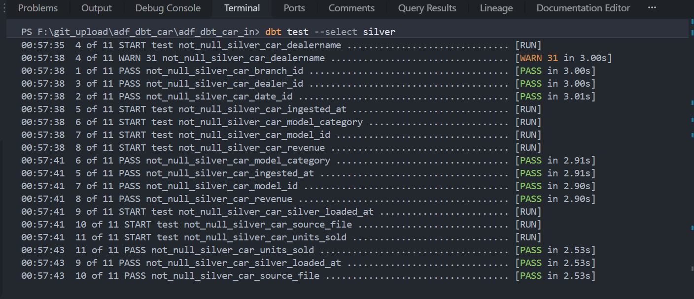

All ten generic data quality tests passed successfully.

Uniqueness tests are not applied to individual business identifiers because multiple sales records may share the same branch, dealer, model or Date_ID.

Dimension-level uniqueness and referential integrity are validated separately in the Gold layer.

### 11.5 Bronze-to-Silver Data Reconciliation

To verify that the Silver transformation preserves the original sales records and business totals, the Bronze and Silver tables were independently reconciled in Databricks.

```sql
select
    'Bronze' as layer,
    count(*) as total_rows,
    sum(revenue) as total_revenue,
    sum(units_sold) as total_units
from cars_catalog.bronze.rawdata

union all

select
    'Silver' as layer,
    count(*) as total_rows,
    sum(revenue) as total_revenue,
    sum(units_sold) as total_units
from cars_catalog.silver.silver_car;
```

**Actual Reconciliation Results:**

| Validation Item | Bronze | Silver | Status |
|---|---:|---:|---|
| Total rows | 1,853 | 1,853 | Passed |
| Total revenue | 19,322,568,069.00 | 19,322,568,069.00 | Passed |
| Total units sold | 3,745 | 3,745 | Passed |

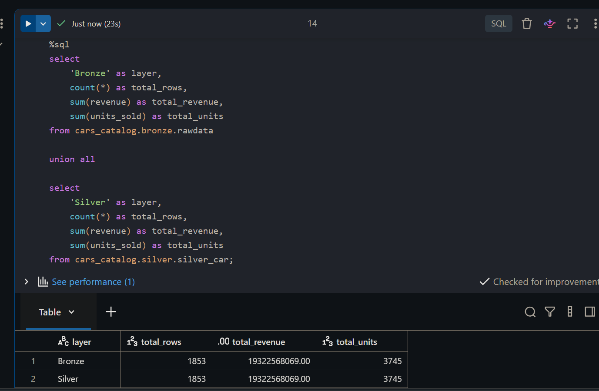

The row counts and aggregated business metrics match exactly between the Bronze and Silver layers.

These results confirm that the transformation preserves the source row count, total revenue and total sales quantity.

The validation complements the dbt not-null tests by verifying aggregate consistency across the two data layers.

### 11.6 Design Decisions and Validation Summary

#### Silver Data Writing — PySpark vs dbt

The reference implementation explicitly writes transformed data to the ADLS Gen2 Silver container using PySpark and Parquet append mode.

In contrast, this project uses dbt table materialization to persist the transformed dataset as a managed Delta table in Databricks Unity Catalog.

| Aspect | Reference Implementation | This Project |
|---|---|---|
| Transformation | PySpark DataFrame API | dbt SQL |
| Storage location | ADLS Gen2 Silver container | Unity Catalog managed storage |
| Storage format | Parquet | Delta |
| Write strategy | Append | Full table rebuild |
| Storage path | Explicit ABFSS path | Managed by Unity Catalog |
| Repeated execution | May duplicate previously processed records | Rebuilds the target table |

This approach eliminates the need to configure an external Silver storage location, simplifies table management and supports development within Databricks Free Edition.

For the current small dataset, full table materialization provides a straightforward and repeatable transformation strategy without accumulating duplicate records from repeated model executions.

#### Why Table Materialization?

The Silver model uses:

```sql
materialized='table'
```

Although the upstream ADF and Bronze ingestion processes support incremental loading, the Silver layer deliberately uses full table materialization.

This design was selected because:

- The current dataset contains only 1,853 records.
- The transformation logic is lightweight.
- Full table rebuilding simplifies transformation logic.
- Repeated executions do not append duplicate records.
- No validated unique sales-event identifier is currently available for incremental MERGE processing.

The Bronze ingestion metadata remains available to support future incremental transformation requirements.

The Silver transformation is therefore a full-table rebuild rather than an incremental dbt model. The `silver_loaded_at` timestamp is refreshed during each rebuild.

#### Processing Strategy by Layer

| Processing Stage | Strategy |
|---|---|
| Azure SQL to ADLS | Watermark-based row-level incremental extraction |
| ADLS to Bronze | File-level incremental ingestion |
| Bronze to Silver | Full table transformation using dbt |

Incremental processing does not need to be applied uniformly across every data layer. The appropriate strategy depends on data volume, transformation complexity, business keys and operational requirements.

#### Functional Validation Checklist

- [x] Bronze source definition
- [x] dbt source dependency
- [x] SQL-based business transformations
- [x] Model category extraction
- [x] Division-by-zero handling in revenue calculation
- [x] Bronze metadata preservation
- [x] Silver table materialization
- [x] Ten generic data quality tests passed
- [x] Bronze-to-Silver row count reconciliation
- [x] Revenue reconciliation
- [x] Units sold reconciliation

The Silver layer has been successfully implemented and validated. The transformed sales dataset is now ready for downstream Gold dimensional modeling.

## 12. Gold — Star Schema 

| Model | Intended grain / key |
| --- | --- |
| dim_branch | One row per Branch_ID |
| dim_dealer | One row per Dealer_ID |
| dim_model | One row per Model_ID |
| dim_date | One row per Date_ID |
| fact_sales | One row per validated source sales event; confirm business grain before selecting a MERGE key |

Use `dbt_utils.generate_surrogate_key` for deterministic dimension keys and join the fact to dimensions on business keys. Validate dimension uniqueness and conflicting attributes before joining. Start with full table models and introduce incremental MERGE after verifying the fact grain and source update semantics. A Date_ID alone is not a fact key.

## 13. PySpark vs dbt — Method Comparison

### 13.1 Same SCD Type 1 Logic, Different Expression

**Classical PySpark SCD Type 1 (dim_model, simplified):**

```python
if not spark.catalog.tableExists('cars_catalog.gold.dim_model'):
    df_sink = spark.sql('''
        SELECT 1 AS dim_model_key, Model_ID, model_category
        FROM parquet.`abfs://silver@.../carsales`
        WHERE 1=0
    ''')
else:
    df_sink = spark.sql('''
        SELECT dim_model_key, Model_ID, model_category
        FROM cars_catalog.gold.dim_model
    ''')

df_filter = df_src.join(df_sink, df_src['Model_ID'] == df_sink['Model_ID'], 'left') \
    .select(df_src['Model_ID'], df_src['model_category'], df_sink['dim_model_key'])

df_filter_old = df_filter.filter(df_filter['dim_model_key'].isNull())

if incremental_flag == '0':
    max_value = 0
else:
    max_value = spark.sql("SELECT MAX(dim_model_key) FROM cars_catalog.gold.dim_model").collect()[0][0]

# Assign new keys
df_filter_old = df_filter_old.withColumn("dim_model_key",
                                         row_number().over(Window.orderBy("Model_ID")) + max_value)

df_final = df_filter.filter(df_filter['dim_model_key'].isNotNull()).union(df_filter_old)

delta_tbl = DeltaTable.forName(spark, 'cars_catalog.gold.dim_model')
delta_tbl.alias("trg").merge(df_final.alias("src"), "trg.dim_model_key = src.dim_model_key") \
    .whenMatchedUpdateAll() \
    .whenNotMatchedInsertAll() \
    .execute()
```

**dbt SCD Type 1 equivalent (dim_model):**

```sql
{{ config(materialized='incremental', schema='gold', unique_key='Model_ID') }}

WITH model_dedup AS (
    SELECT
        Model_ID,
        SPLIT(Model_ID, '-')[0] AS model_category
    FROM {{ ref('silver_car') }}
    GROUP BY Model_ID, SPLIT(Model_ID, '-')[0]
)

SELECT
    {{ dbt_utils.generate_surrogate_key(['Model_ID']) }} AS dim_model_key,
    Model_ID,
    model_category
FROM model_dedup
```

**Illustrative equivalent SCD1 upsert pattern. Verify one row per Model_ID before MERGE.**

| Aspect | PySpark reference | dbt approach |
| --- | --- | --- |
| Transformations | DataFrame operations | SQL models |
| SCD1 | Explicit Delta MERGE | Incremental MERGE with unique_key |
| Surrogate keys | ROW_NUMBER + MAX allocation | Deterministic hash (collisions theoretically possible) |
| Dependencies | Explicit job tasks | ref() DAG within dbt |
| Scheduling | External orchestrator | External orchestrator |
| Tests | Manual or custom | Generic and singular tests |

## 14. Data Quality and End-to-End Verification

### 14.1 The Incremental Source

A new file is added to the Git repository:

**`Azure-DE-Project-Resources/Raw Data/IncrementalSales.csv`**

```
Branch_ID  Dealer_ID  Model_ID  Revenue    Units_Sold  Date_ID   Day  Month  Year  BranchName           DealerName               Product_Name
BR9546     DLR0060    Jee-M10   7223451    1           DT01246   28   5      2020  Premier Motors       Fisker, Karma Motors     Jeep
BR9666     DLR0062    Jee-M12   22093020   3           DT01246   30   5      2020  Puma Motors          Ford Australia Motors    Jeep
BR9726     DLR0063    Jee-M13   22372413   3           DT01247   31   5      2020  Power Ranger Motors  Ford do Brasil Motors    Jeep
XYZ9726    XYZ0063    ZYXM13    22372413   3           DT01247   31   5      2020  DataFam Motors       DataFam Dealers          Surprise
```

**Key observation:** Row 4 (`XYZ9726` / `XYZ0063` / `ZYXM13`) consists
entirely of **new dimension members** that do not exist in any
previously loaded data.

### 14.2 Validation checklist

- Confirm initial CSV and SQL counts match.
- Confirm full load SQL and ADLS counts match.
- Verify the watermark advances only after successful extraction.
- Ingest IncrementalSales.csv once and verify the new date IDs and dimension members.
- Run the pipeline without new data and verify no duplicate records.
- Validate Bronze file tracking and failure retries.
- Run dbt tests for dimension keys, fact grain, not-null fields and relationships; reconcile revenue and units sold.

The earlier notes report 28 passing dbt tests and new dimension members XYZ9726, XYZ0063 and ZYXM13. They show four incremental source rows but report five new fact rows; reconcile this discrepancy against actual source and target counts. No previous test result is claimed as a result of the revised architecture.

## 15. Design Decisions and Known Limitations

- Fixed-width Date_ID ordering must match arrival order. Late arrivals at or below the watermark and updates to older rows are not captured. A composite cursor can help with ties if it reflects arrival order; downstream MERGE alone cannot recover rows never extracted.
- SQL watermark state and ADLS writes are not atomic together. Use retry-safe sink writes and serialized runs; a no-change rerun is not proof of failure recovery.
- File selection via load_flag does not prevent duplicate SQL inserts.
- Container-level SAS connectivity and Pandas-based Bronze
  ingestion have been successfully validated. The implementation
  assumes immutable source files and sequential execution.
  Keep credentials outside Git; use least privilege and short expiry.
- Hash keys are deterministic, not collision-free. dbt MERGE requires a valid unique key and deduplicated input. Incremental materialization alone does not guarantee incremental source scanning or idempotency.
- Azure SQL, ADF and ADLS may incur charges even when Databricks is free.

## 16. References

- Tutorial: https://www.youtube.com/watch?v=6_hXeNg9TJ0&t=3s
- Source files: https://github.com/anshlambagit/Azure-DE-Project-Resources/tree/main/Raw%20Data
